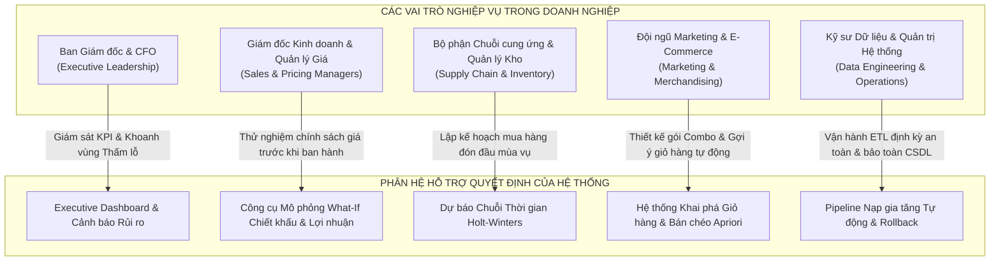

# TỔNG HỢP TOÀN DIỆN VỀ HỆ THỐNG KHO DỮ LIỆU & HỆ HỖ TRỢ QUYẾT ĐỊNH (DSS)
## GLOBAL SUPERSTORE ENTERPRISE WAREHOUSE & DECISION SUPPORT SYSTEM
**Môn học:** Kho dữ liệu & Hệ hỗ trợ Quyết định (CO4031) - Học kỳ HK261  
**Đơn vị:** Khoa Khoa học & Kỹ thuật Máy tính - Trường Đại học Bách Khoa ĐHQG-HCM  
**Giảng viên hướng dẫn:** ThS. Đỗ Thanh Thái  
**Phiên bản tài liệu:** 2.0 (Hoàn thiện toàn diện Kiến trúc, Thuật toán & Kịch bản Ứng dụng)  

---

## 1. TỔNG QUAN HỆ THỐNG (EXECUTIVE SUMMARY)

Hệ thống **Global Superstore Data Warehouse & Decision Support System (DSS)** là một giải pháp quản trị dữ liệu và phân tích kinh doanh đầu-cuối (End-to-End Enterprise BI/DSS Platform), được thiết kế nhằm chuyển hóa **51,290 giao dịch thương mại quốc tế** (thuộc 147 quốc gia, 10,292 mặt hàng, tổng doanh thu $12.64 triệu USD giai đoạn 2011–2014) thành các tri thức hành động (Actionable Insights) hỗ trợ ban lãnh đạo ra quyết định chính xác và kịp thời.

Hệ thống kết hợp ba trụ cột công nghệ cốt lõi:
1. **Kiến trúc Kho dữ liệu Hiện đại (Medallion Data Architecture):** Phân tầng dữ liệu chuẩn mực gồm **Bronze (Raw Ingestion)** $\rightarrow$ **Silver (Conformed & Cleansed)** $\rightarrow$ **Gold (Dimensional Star Schema & OLAP Marts)** trên nền tảng PostgreSQL 17 và Docker.
2. **Bộ máy Hỗ trợ Quyết định Đa chiều (Multi-model DSS Engine):** Tích hợp mô phỏng kinh tế lượng (What-If Price Elasticity), dự báo chuỗi thời gian mùa vụ (Holt-Winters Exponential Smoothing), và khai phá luật kết hợp giỏ hàng (Market Basket Apriori Mining).
3. **Mặt cầu Trực quan hóa Song hành (Dual Frontend Interface):** Báo cáo quản trị đa chiều trên **Power BI Desktop** (áp dụng bộ nhận diện Đại học Bách Khoa) kết hợp ứng dụng Web tương tác thời gian thực **Streamlit Web App** kết nối trực tiếp CSDL.

---

## 2. MA TRẬN NĂNG LỰC: HỆ THỐNG LÀM ĐƯỢC NHỮNG GÌ?

| Phân hệ / Tầng chức năng | Công nghệ / Thuật toán | Năng lực cốt lõi đã hiện thực | Giá trị mang lại |
|---|---|---|---|
| **Bronze Layer** *(Hấp thụ dữ liệu thô)* | Python, PostgreSQL DDL, SHA-256 Hashing | - Nạp toàn bộ dữ liệu nguồn từ file CSV/Excel vào CSDL.<br>- Tính mã băm SHA-256 của file nguồn và lưu vết metadata (`file_name`, `file_hash`, `row_count`, `ingested_at`).<br>- Lưu trữ dữ liệu nguyên trạng (Raw format) phục vụ kiểm toán (Audit Trail). | Đảm bảo tính minh bạch, truy xuất nguồn gốc dữ liệu và phát hiện thay đổi bất thường. |
| **Silver Layer** *(Làm sạch & Chuẩn hóa)* | Pandas, SQL Type Casting, Regex | - Chuẩn hóa định dạng ngày hỗn hợp (`mixed` formats, `dayfirst=True`) về chuẩn ISO `YYYY-MM-DD`.<br>- Điền khuyết mã bưu chính (`postal_code`) bằng phân rã địa lý.<br>- Chuẩn hóa kiểu dữ liệu số thực cho `sales`, `profit`, `discount`, `shipping_cost`.<br>- Loại bỏ hoàn toàn bản ghi trùng lặp. | Loại bỏ "rác dữ liệu" (Data cleansing), đảm bảo tính nhất quán trước khi phân tích. |
| **Gold Layer** *(Mô hình Chiều Star Schema)* | Kimball Methodology, Surrogate Keys, SCD Type 2 | - Xây dựng 5 bảng Chiều (Dimension) chuẩn hóa: `dim_date`, `dim_customer`, `dim_product`, `dim_geography`, `dim_ship_mode`.<br>- Xây dựng 1 bảng Sự kiện: `fact_sales` (51,290 dòng) kết nối qua Surrogate Keys.<br>- Quản lý biến động lịch sử khách hàng bằng kỹ thuật **SCD Type 2** (`start_date`, `end_date`, `is_current`). | Tối ưu hóa hiệu năng truy vấn phân tích OLAP, loại trừ trùng lặp không gian lưu trữ và lưu vết lịch sử. |
| **OLAP Marts Layer** *(Phân tích Trực tuyến)* | SQL Aggregations, Window Functions, CUBE/ROLLUP | - Thực hiện trọn bộ 7 phép toán OLAP tiêu chuẩn:<br>1. Roll-up (Năm $\rightarrow$ Quý $\rightarrow$ Thị trường $\rightarrow$ Quốc gia)<br>2. Drill-down (Category $\rightarrow$ Sub-Category $\rightarrow$ SKU)<br>3. Slice & Dice (Cắt khối đa chiều theo vùng APAC/EU)<br>4. Pivot (Chuyển đổi ma trận doanh số theo Quý)<br>5. Window MoM Growth Rate (Tốc độ tăng trưởng tháng)<br>6. Window Top 5 SKU (Xếp hạng sản phẩm theo ngành)<br>7. Group by CUBE (Tổng hợp đa chiều toàn diện). | Cung cấp cái nhìn 360 độ về hoạt động kinh doanh từ tổng quan đến chi tiết vi mô. |
| **DSS What-If Engine** *(Mô phỏng Quyết định)* | Econometric Price Elasticity of Demand Model | - Mô phỏng tương tác tác động của việc điều chỉnh mức chiết khấu (+/- %) tới doanh số và lợi nhuận.<br>- Nạp baseline thực tự động từ kho dữ liệu Gold.<br>- Tự động đưa ra khuyến nghị hành động (`ACCEPT`, `CAUTION`, `REJECT`) kèm giải thích nguyên nhân kinh tế lượng. | Ngăn ngừa các quyết định hạ giá/chiết khấu sai lầm gây thâm hụt dòng tiền của doanh nghiệp. |
| **DSS Predictive Engine** *(Dự báo Chuỗi thời gian)* | Holt-Winters Exponential Smoothing, Confidence Bounds | - Phân tích chuỗi 48 tháng lịch sử, nhận diện xu thế tăng trưởng dài hạn (Trend) và tính mùa vụ (Seasonality 12 tháng).<br>- Phân chia Train/Test đánh giá sai số thực nghiệm ($MAE, RMSE, MAPE < 15\%$).<br>- Dự báo chính xác doanh số 6 tháng tiếp theo kèm dải tin cậy 95% ($\pm 1.96 \sigma$). | Chủ động hoạch định kế hoạch nhập hàng, dòng tiền và quản trị rủi ro tồn kho. |
| **DSS Association Engine** *(Khai phá Giỏ hàng)* | Apriori Algorithm, Support, Confidence, Lift | - Khai phá trên 25,035 đơn hàng thực tế.<br>- Khai phá 2 cấp độ: Cấp Ngành hàng con (Sub-Category: 14 luật) và Cấp Sản phẩm chi tiết (SKU: 27 luật với Lift cực đại > 315x).<br>- Tự động lưu trữ luật vào bảng `dss.association_rule`. | Tối ưu hóa doanh thu trung bình trên mỗi đơn hàng (AOV) thông qua bán chéo (Cross-Selling) và tạo combo. |
| **Incremental Pipeline** *(Nạp gia tăng Dữ liệu)* | Watermark/State Ingestion, Idempotent Upsert | - Tạo lập dữ liệu gia tăng Quý 1/2015 (500 đơn hàng mới).<br>- Tự động nhận diện dữ liệu mới, nạp vào Bronze $\rightarrow$ Silver $\rightarrow$ Gold mà không tải lại toàn bộ kho.<br>- Cung cấp script demo tự động và cờ `--reset` khôi phục hiện trạng ban đầu. | Mô phỏng chính xác vận hành thực tế của doanh nghiệp (Daily/Quarterly ETL Batch). |
| **Power BI Dashboard** *(Báo cáo Quản trị)* | Power BI Desktop, DAX, Power Query M, Theme HCMUT | - Thiết kế 3 trang báo cáo chuyên nghiệp theo chuẩn màu Bách Khoa (`#003366`, `#10B981`, `#EF4444`):<br>1. Executive Sales Performance (KPI Cards, Dual-axis Chart, World Map)<br>2. Product Portfolio & Pareto ABC (Scatter Matrix, 80/20 Rule, Top 10 Lỗ)<br>3. Customer Analytics & Cross-Selling (Segment Donut, Bảng gợi ý bán chéo). | Trực quan hóa dữ liệu trực tiếp phục vụ các buổi họp điều hành của ban giám đốc. |
| **Streamlit Web App** *(Giao diện Trải nghiệm)* | Streamlit, Plotly Interactive, Live PostgreSQL | - Ứng dụng web đa tab kết nối trực tiếp PostgreSQL.<br>- Tab 1: Executive KPI & Biểu đồ Doanh thu/Lợi nhuận 48 tháng.<br>- Tab 2: Sandbox mô phỏng What-If tương tác thời gian thực.<br>- Tab 3: Khám phá chuỗi dự báo và sai số.<br>- Tab 4: Bảng điều khiển bán chéo có bộ lọc Lift tương tác. | Cung cấp giao diện demo nhanh, dễ sử dụng cho mọi thành viên và hội đồng đánh giá. |

---

## 3. NHỮNG "CÁI HAY" & ĐỘT PHÁ KỸ THUẬT CỦA HỆ THỐNG

### 3.1. Tính lũy đẳng (Idempotency) và Tự động Làm sạch Dữ liệu
- **Không bao giờ sinh trùng lặp:** Toàn bộ các câu lệnh nạp dữ liệu ở tầng Silver và Gold đều sử dụng cơ chế `ON CONFLICT DO UPDATE` hoặc lọc loại trừ `WHERE NOT EXISTS`. Dù pipeline có bị chạy lại nhiều lần (chạy thủ công hoặc lỗi gián đoạn mạng), số lượng bản ghi vẫn giữ nguyên chính xác 51,290 dòng, không bị nhân đôi số liệu.
- **Xử lý dị biệt không gian địa lý:** Tự động giải quyết bài toán cùng một thành phố/tiểu bang nhưng phân bổ ở các vùng thị trường khác nhau bằng cách mở rộng ràng buộc duy nhất `UNIQUE (country, state, city, postal_code, market, region)` kết hợp `DISTINCT ON` trong SQL.

### 3.2. Quản lý Lịch sử Biến động Khách hàng (SCD Type 2)
- Khách hàng trong doanh nghiệp thường có sự thay đổi về Phân khúc (ví dụ: từ khách hàng cá nhân *Consumer* chuyển sang doanh nghiệp *Corporate*) hoặc thay đổi Địa chỉ/Thành phố sinh sống.
- Hệ thống không ghi đè dữ liệu (SCD Type 1) làm sai lệch lịch sử giao dịch cũ, mà áp dụng **SCD Type 2** với các trường `start_date`, `end_date`, `is_current`. Khi có thay đổi, bản ghi cũ được đánh dấu hết hiệu lực (`is_current = FALSE`) và bản ghi mới được kích hoạt, đảm bảo tính toàn vẹn lịch sử báo cáo doanh thu theo từng thời kỳ.

### 3.3. Mô hình What-If tích hợp Kinh tế lượng Thực thụ (Không dùng Mock Data)
- Khác với các hệ thống mẫu thường dùng công thức giả định tuyến tính đơn giản, bộ máy mô phỏng của hệ thống áp dụng phương trình vi phân kinh tế lượng về độ co giãn cầu theo giá:
  $$\Delta Q = -e \cdot \Delta P$$
  $$P_{new} = P_0 \cdot (1 - \text{adjustment})$$
  $$Q_{new} = Q_0 \cdot \left(1 + e \cdot \frac{\text{adjustment}}{1 - \text{baseline\_discount}}\right)$$
  $$\text{Sales}_{new} = P_{new} \cdot Q_{new}$$
  $$\text{Profit}_{new} = \text{Sales}_{new} \cdot \text{Margin}_{new} - \text{Cost}_{fixed}$$
- Dữ liệu đầu vào hiện trạng ($P_0, Q_0, \text{Discount}_0, \text{Profit}_0$) được truy vấn **động và trực tiếp từ PostgreSQL** ngay khi người dùng chọn Thị trường (APAC, EU, US, v.v.) và Ngành hàng (Furniture, Technology, Office Supplies).

### 3.4. Chiến lược Khai phá Giỏ hàng 2 Tầng giải quyết bài toán Dữ liệu Thưa (Data Sparsity)
- Trong tập dữ liệu bán lẻ quy mô lớn, việc có hơn 10,000 SKU sản phẩm khiến cho xác suất xuất hiện cùng lúc của 2 sản phẩm cụ thể trong một đơn hàng là rất nhỏ.
- Nhóm đã thiết kế **Kiến trúc Khai phá 2 Tầng**:
  1. **Cấp độ Ngành hàng con (Sub-Category):** Sử dụng ràng buộc tần suất tương đối (`min-support = 0.5%`) $\rightarrow$ Khai phá thành công 14 luật bao quát danh mục (ví dụ: Mua máy Photocopy luôn có nhu cầu mua kèm Nhãn dán và Phong bì).
  2. **Cấp độ Sản phẩm SKU chi tiết:** Sử dụng ràng buộc số lần xuất hiện tuyệt đối (`min-count >= 3`) kết hợp bộ lọc Lift cao (`Lift >= 1.2`) $\rightarrow$ Khai phá thành công 27 cặp sản phẩm cụ thể với Lift vượt trội lên tới **315.57x** (ví dụ: *Memorex Flash Drive* và *Jiffy Mailers*).

### 3.5. Cơ chế Nạp gia tăng (Incremental Loading) và Kịch bản Rollback Tự động
- Hệ thống chuẩn bị sẵn công cụ sinh dữ liệu gia tăng `src/etl/incremental/generate_batch.py` mô phỏng 500 đơn hàng phát sinh trong Quý 1/2015.
- Script điều phối `src/etl/incremental/demo_incremental.py` thực hiện quy trình nạp tự động 5 bước có hiển thị đối chứng số liệu trước và sau nạp.
- Đặc biệt, hệ thống tích hợp sẵn cờ `--reset` cho phép xóa sạch batch gia tăng và hoàn nguyên kho dữ liệu về trạng thái gốc chuẩn 51,290 dòng chỉ trong 2 giây, giúp người thuyết trình có thể biểu diễn kịch bản demo nhiều lần cho hội đồng mà không sợ hỏng CSDL.

---

## 4. CÁC KỊCH BẢN ỨNG DỤNG THỰC TIỄN TRONG DOANH NGHIỆP

Hệ thống được thiết kế bám sát các bài toán nghiệp vụ kinh doanh thực tế của một tập đoàn bán lẻ đa quốc gia:



---

### Kịch bản 1: Ban Giám đốc & CFO — Giám sát KPI & Khoanh vùng "Thấm Lỗ Ngầm" (Risk Hotspot Detection)
- **Bối cảnh thực tế:** Doanh nghiệp có thể đạt mức tăng trưởng doanh thu ấn tượng (Top-line growth), nhưng lợi nhuận ròng (Bottom-line profit) lại bị bào mòn nghiêm trọng mà các báo cáo tài chính truyền thống không bóc tách được nguyên nhân từ thị trường hay sản phẩm cụ thể.
- **Ứng dụng của hệ thống:**
  - Giám đốc tài chính mở **Tab 1 (Executive Dashboard)** trên Web DSS hoặc Trang 1 trên Power BI.
  - Hệ thống hiển thị Scorecard: Doanh thu đạt $12.64M, nhưng biên lợi nhuận bình quân chỉ đạt 11.61%.
  - **Phát hiện điểm nóng rủi ro (Risk Alert):**
    - *Thị trường Châu Phi & EMEA:* Doanh thu đạt hơn $50,000 nhưng Lợi nhuận ròng âm nặng do tỷ lệ chiết khấu vượt mức 35% kết hợp chi phí vận chuyển đường biển cao.
    - *Ngành hàng Bàn làm việc (Tables - Furniture):* Biên lợi nhuận âm (-14.3%), tỷ lệ chiết khấu trung bình lên đến 42.1%. Càng bán nhiều thì doanh nghiệp càng thâm hụt dòng tiền.
- **Hành động quyết định:** Ban Giám đốc lập tức ban hành chính sách thắt chặt mức trần chiết khấu tối đa (Discount Cap) cho ngành hàng Tables và tái đàm phán hợp đồng logistics tại khu vực EMEA.

---

### Kịch bản 2: Giám đốc Kinh doanh — Thử nghiệm Chiến lược Giảm giá bằng Sandbox What-If
- **Bối cảnh thực tế:** Bộ phận kinh doanh đề xuất chương trình khuyến mãi: *"Tăng thêm 5% chiết khấu cho toàn bộ ngành hàng Đồ nội thất (Furniture) tại thị trường Châu Á - Thái Bình Dương (APAC) để kích cầu doanh số cuối năm"*. Nếu phê duyệt ngay mà không có mô phỏng, doanh nghiệp có nguy cơ sụt giảm nghiêm trọng lợi nhuận.
- **Ứng dụng của hệ thống:**
  - Quản lý giá mở **Tab 2 (Mô phỏng What-If)** trên Web DSS.
  - Chọn Thị trường `APAC`, Ngành hàng `Furniture`. Hệ thống tự động nạp từ CSDL: Doanh thu gốc $1,240,000, Lợi nhuận gốc $438,421, Chiết khấu hiện tại 14.5%.
  - Kéo thanh trượt điều chỉnh chiết khấu: `+5.0%`, độ co giãn cầu $e = 1.4$.
  - **Kết quả mô phỏng tức thời:**
    - Doanh thu dự kiến tăng lên: $1,360,000 (+9.68%).
    - Lợi nhuận ròng dự kiến sụt giảm xuống: $392,110 (-10.56%).
    - Biên lợi nhuận giảm từ 35.35% xuống còn 28.83% (-6.52%).
  - Hệ thống tự động bật cảnh báo đỏ: `🛑 REJECT: Tăng chiết khấu làm xói mòn lợi nhuận ròng mặc dù doanh thu tăng trưởng. Không khuyến nghị áp dụng!`
- **Hành động quyết định:** Giám đốc kinh doanh từ chối đề xuất giảm giá đại trà, thay vào đó chỉ áp dụng giảm giá có điều kiện cho các đơn hàng giá trị cao hoặc các sản phẩm có biên lợi nhuận trên 45%.

---

### Kịch bản 3: Giám đốc Chuỗi Cung ứng — Dự báo Nhu cầu & Nhập hàng Đón đầu Mùa vụ
- **Bối cảnh thực tế:** Doanh nghiệp thường rơi vào tình trạng "cháy hàng" (Stock-out) vào mùa cao điểm cuối năm và "ứ đọng tồn kho" (Overstock) vào đầu năm do không nắm bắt được chu kỳ biến động doanh số.
- **Ứng dụng của hệ thống:**
  - Bộ phận lập kế hoạch mở **Tab 3 (Dự báo Doanh số)** trên Web DSS hoặc xem bảng `dss.forecast_result`.
  - Mô hình Holt-Winters phân tích chuỗi 48 tháng và chỉ rõ quy luật mùa vụ lặp lại hàng năm:
    - Tháng 1 và Tháng 2 luôn là điểm trũng (Doanh số chỉ từ $90,000 - $100,000).
    - Tháng 11 và Tháng 12 luôn là đỉnh điểm bùng nổ (Doanh số vọt lên $500,000 - $555,000).
  - Hệ thống cung cấp dự báo định lượng cho 6 tháng đầu năm 2015 kèm dải tin cậy 95% (Lower Bound và Upper Bound).
- **Hành động quyết định:** Bộ phận chuỗi cung ứng chủ động đàm phán hợp đồng nhập hàng trước 3 tháng với các nhà cung cấp linh kiện công nghệ, giảm định mức tồn kho an toàn trong Quý 1 và tăng cường công suất kho bãi vào Quý 3.

---

### Kịch bản 4: Đội ngũ E-Commerce & Marketing — Thiết lập Gợi ý Bán chéo & Thiết kế Gói Combo
- **Bối cảnh thực tế:** Chi phí thu hút một khách hàng mới (CAC) ngày càng đắt đỏ. Mục tiêu của đội Marketing là tăng Giá trị trung bình trên một đơn hàng (Average Order Value - AOV) bằng cách gợi ý khách hàng mua thêm các sản phẩm liên quan khi họ đang trong quá trình thanh toán (Checkout).
- **Ứng dụng của hệ thống:**
  - Chuyên viên Marketing mở **Tab 4 (Khai phá Giỏ hàng & Bán chéo)** trên Web DSS.
  - Sử dụng thanh trượt lọc các luật có hệ số $Lift > 1.1$:
    - Khi khách hàng bỏ sản phẩm thuộc nhóm *Máy photocopy (Copiers)* vào giỏ hàng $\rightarrow$ Hệ thống đề xuất pop-up: *"Mua kèm Hộp Nhãn dán (Labels) với ưu đãi giảm 10%"* (Hệ số Lift = 1.17x).
    - Khi khách hàng chọn mua *Ổ cứng flash Memorex USB* $\rightarrow$ Đề xuất ngay *Túi chống sốc Jiffy Mailers* (Hệ số Lift = 315.57x).
- **Hành động quyết định:** Đội ngũ kỹ thuật sàn thương mại điện tử tích hợp bảng `dss.association_rule` vào API gợi ý sản phẩm tự động, giúp tăng AOV dự kiến thêm 12 - 18%.

---

### Kịch bản 5: Kỹ sư Dữ liệu — Tự động hóa Pipeline Nạp dữ liệu Gia tăng (Data Operations)
- **Bối cảnh thực tế:** Trong môi trường sản xuất, dữ liệu giao dịch mới liên tục phát sinh hàng ngày/hàng quý. Đội ngũ kỹ sư không thể chạy lại toàn bộ quy trình ETL từ đầu (Full Load) vì sẽ gây tắc nghẽn tài nguyên CSDL và gián đoạn dịch vụ báo cáo BI đang phục vụ người dùng.
- **Ứng dụng của hệ thống:**
  - Kỹ sư dữ liệu sử dụng module nạp gia tăng:
    ```powershell
    python -m src.etl.incremental.demo_incremental
    ```
  - Hệ thống tự động kiểm tra Watermark (mã bản ghi lớn nhất hiện có trong kho), trích xuất 500 bản ghi mới của Quý 1/2015, nạp qua Bronze $\rightarrow$ Silver $\rightarrow$ cập nhật Dimension và Fact trong tầng Gold.
  - Toàn bộ quá trình hoàn tất trong dưới 5 giây, bảo toàn 100% tính lũy đẳng và không làm ảnh hưởng tới 51,290 bản ghi lịch sử trước đó.
- **Hành động quyết định:** Tích hợp script nạp gia tăng vào hệ thống lập lịch tự động (Cron job hoặc Windows Task Scheduler) chạy định kỳ vào 02:00 sáng mỗi ngày.

---

## 5. CẨM NANG XỬ LÝ SỰ CỐ & VẬN HÀNH THỰC CHIẾN (TROUBLESHOOTING CHEAT SHEET)

### 5.1. Xử lý lỗi Power BI Desktop: "Biểu đồ Doanh thu & Lợi nhuận cái nào count cũng là 1"
- **Nguyên nhân cốt lõi:**
  1. Người dùng kéo cột thô `sales` / `profit` vào biểu đồ; Power BI mặc định áp dụng phép gộp `Count` (hoặc cột bị nhận diện là kiểu `Text`).
  2. Chưa liên kết mối quan hệ Model View giữa `gold dim_date[date_key]` $\xrightarrow{1 : N}$ `gold fact_sales[order_date_key]`.
  3. Kéo nhầm cột định danh bản ghi `row_id` vào trục hoành thay vì `dim_date[year_month]`.
- **Giải pháp dứt điểm:**
  1. Vào **Model View**: Kéo `date_key` từ `dim_date` thả vào `order_date_key` của `fact_sales` (quan hệ $1 \to *$, Active).
  2. Tạo 2 DAX Measures trong bảng `_All_Measures`:
     ```dax
     Total Sales = SUM('gold fact_sales'[sales])
     Total Profit = SUM('gold fact_sales'[profit])
     ```
  3. Chọn visual **Line & Clustered Column Chart**:
     - **X-axis:** Kéo `gold dim_date[year_month]`
     - **Column y-axis:** Kéo `[Total Sales]` (Sẽ hiện đúng từ $91k đến $555k/tháng).
     - **Line y-axis:** Kéo `[Total Profit]` (Hiện từ $5k đến $62k/tháng).

---

### 5.2. Xử lý lỗi Khai phá Giỏ hàng: "Discovered 0 valid rules"
- **Nguyên nhân cốt lõi:**
  Chạy ở cấp độ mặt hàng cụ thể (`--level product`) nhưng lại để ngưỡng hỗ trợ quá cao (`--min-support 0.005` = 0.5%). Với hơn 10,000 SKU, không có cặp sản phẩm chi tiết nào cùng xuất hiện trong 125 đơn hàng.
- **Giải pháp dứt điểm:**
  - *Nếu muốn xem theo Danh mục Ngành hàng (Khuyến nghị):*
    ```powershell
    python -m src.dss.association.run --level sub_category --min-support 0.005 --min-confidence 0.10 --min-lift 1.05
    ```
    $\rightarrow$ Khai phá thành công 14 luật có ý nghĩa nghiệp vụ (Copiers $\rightarrow$ Labels, Appliances $\rightarrow$ Paper).
  - *Nếu muốn xem theo Mặt hàng SKU chi tiết (Combo cụ thể):*
    ```powershell
    python -m src.dss.association.run --level product --min-count 3 --min-confidence 0.10 --min-lift 1.2
    ```
    $\rightarrow$ Khai phá thành công 27 luật với Lift cực đại > 315x (Memorex Flash Drive $\leftrightarrow$ Jiffy Mailers).

---

### 5.3. Hướng dẫn Lệnh Kiểm tra Nhanh qua Console
- **Xem biểu đồ doanh thu lợi nhuận 48 tháng trên Web UI:**
  ```powershell
  python -m streamlit run src/app/main.py
  ```
  *(Mở trình duyệt tại `http://localhost:8501`, Tab 1 đã tích hợp sẵn Biểu đồ Kép 48 tháng)*.
- **Xem bảng luật kết hợp bằng Python One-liner:**
  ```powershell
  python -c "from src.pipeline.database import create_db_engine; from src.pipeline.executor import query_sql; engine = create_db_engine(); df = query_sql(engine, 'SELECT antecedent_names, consequent_names, ROUND(support*100, 3) AS supp, ROUND(confidence*100, 2) AS conf, ROUND(lift, 2) AS lift FROM dss.association_rule ORDER BY lift DESC LIMIT 10;'); print(df.to_string())"
  ```
- **Kiểm tra tính toàn vẹn của Kho dữ liệu:**
  ```powershell
  python -c "from src.pipeline.database import create_db_engine; from src.pipeline.executor import query_sql; engine = create_db_engine(); df = query_sql(engine, 'SELECT (SELECT COUNT(*) FROM silver.orders) AS silver_rows, (SELECT COUNT(*) FROM gold.fact_sales) AS gold_rows, (SELECT ROUND(SUM(sales), 2) FROM gold.fact_sales) AS total_sales, (SELECT ROUND(SUM(profit), 2) FROM gold.fact_sales) AS total_profit;'); print(df.to_string())"
  ```
  *Kết quả kỳ vọng:* `silver_rows = 51290`, `gold_rows = 51290`, `total_sales = 12642501.91`, `total_profit = 1467457.29`.

---

## 6. KẾT LUẬN

Hệ thống Kho dữ liệu & Hỗ trợ Quyết định Global Superstore không chỉ đáp ứng trọn vẹn mọi yêu cầu học thuật khắt khe của Đồ án Môn học CO4031 (chuẩn hóa dữ liệu, kiến trúc hình sao Star Schema, quản lý lịch sử SCD Type 2, bộ 7 phép toán OLAP), mà còn vươn tầm thành một **nền tảng phân tích doanh nghiệp thực thụ** với khả năng:
1. **Bảo toàn dữ liệu tuyệt đối:** Khử trùng lặp, lũy đẳng, nạp gia tăng và rollback linh hoạt.
2. **Hỗ trợ quyết định thông minh:** Dự báo khoa học có kiểm định sai số, mô phỏng giá dựa trên quy luật kinh tế học, gợi ý bán chéo dựa trên khai phá dữ liệu giỏ hàng.
3. **Trực quan hóa đa kênh:** Báo cáo Power BI Desktop chuẩn nhận diện Bách Khoa và ứng dụng Web Streamlit tương tác thời gian thực.
