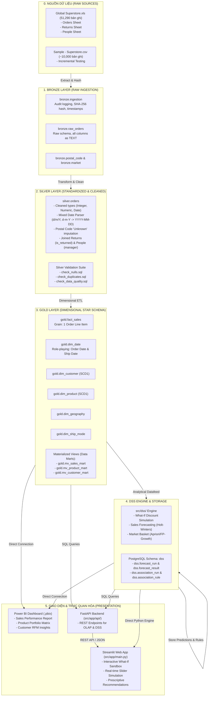

# KIẾN TRÚC TỔNG THỂ HỆ THỐNG KHO DỮ LIỆU & HỆ HỖ TRỢ QUYẾT ĐỊNH
## GLOBAL SUPERSTORE DATA WAREHOUSE & DECISION SUPPORT SYSTEM (DSS)

> **Môn học:** Kho dữ liệu và Hệ hỗ trợ Quyết định (CO4031) - HK261, ĐH Bách Khoa ĐHQG-HCM  
> **Tài liệu đặc tả SSOT chính:** [docs/ssot/index.md](file:///e:/bku/261/DW/codebase/Global-Superstore-warehouse-and-DSS/docs/ssot/index.md)

---

## 1. SƠ ĐỒ KIẾN TRÚC TỔNG THỂ (SYSTEM ARCHITECTURE DIAGRAM)

---

## 2. NGUYÊN TẮC THIẾT KẾ CỐT LÕI (CORE DESIGN PRINCIPLES)

1. **Tuân thủ Chuẩn mực Ralph Kimball:**
   - Fact table được xây dựng tại mức hạt chi tiết nhất (**Atomic Grain** = 1 dòng sản phẩm trong đơn hàng).
   - Tất cả các bảng Dimension sử dụng Khóa thay thế số nguyên (**Surrogate Keys** `SERIAL` / `INTEGER`) thay vì dựa vào Natural Keys để tăng tốc độ truy vấn và hỗ trợ nạp dữ liệu từ nhiều nguồn.
   - `DimDate` là một **Role-Playing Dimension** được nối 2 lần với `FactSales` qua `order_date_key` và `ship_date_key`.

2. **Khung lý thuyết DSS của Efraim Turban & Herbert Simon:**
   - Hệ thống không dừng lại ở việc báo cáo quá khứ (Descriptive Analytics qua Power BI), mà cung cấp bộ công cụ tương tác giải quyết bài toán bán cấu trúc:
     - **What-If Simulation:** Mô phỏng sự biến thiên của lợi nhuận ròng khi thay đổi chiết khấu dựa trên độ co giãn cầu $e$.
     - **Predictive Analytics:** Dự báo chuỗi thời gian doanh số tương lai kèm khoảng tin cậy 95%.
     - **Prescriptive Recommendations:** Đưa ra khuyến nghị tự động (Approve / Caution / Reject) giúp nhà quản trị ra quyết định tối ưu.

3. **Mô hình Song hành (Hybrid UI Architecture):**
   - **Power BI (.pbix):** Chuyên phục vụ báo cáo BI đa chiều, cắt lát dữ liệu, drill-down nhanh.
   - **Python DSS Web App (Streamlit + FastAPI):** Chuyên phục vụ tính năng tương tác What-If trực tiếp, dự báo và đề xuất bán chéo theo thời gian thực.
