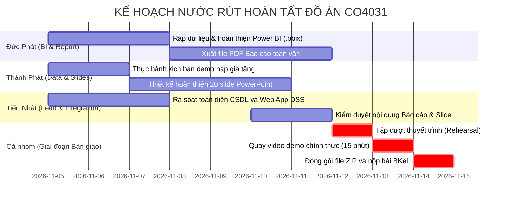

# KẾ HOẠCH TỔNG THỂ & LỘ TRÌNH CÁC BƯỚC TIẾP THEO (NEXT STEPS ROADMAP)
## DỰ ÁN: KHO DỮ LIỆU & HỆ HỖ TRỢ QUYẾT ĐỊNH (GLOBAL SUPERSTORE)
**Môn học:** Kho dữ liệu và Hệ hỗ trợ Quyết định (CO4031) - HK261  
**Khoa:** Khoa Khoa học và Kỹ thuật Máy tính - Trường Đại học Bách Khoa ĐHQG-HCM  
**Thời hạn chót nộp bài (Hard Deadline):** **23:59 Chủ Nhật, ngày 15/11/2026**

---

## 1. TỔNG QUAN HIỆN TRẠNG DỰ ÁN

| Phân hệ kỹ thuật | Khối lượng đã hoàn thành | Trạng thái kỹ thuật | Đánh giá nghiệm thu |
|---|:---:|:---:|---|
| **1. Khảo sát nghiệp vụ & KPI** | 100% | ĐÃ HOÀN THÀNH | Đầy đủ 15+ KPIs cốt lõi, bộ câu hỏi S01-S07, P01-P08, C01-C07. |
| **2. Star Schema & CSDL (Init DDL)** | 100% | ĐÃ HOÀN THÀNH | 4 schemas (`bronze`, `silver`, `gold`, `dss`), 15 bảng, 1 Fact, 5 Dims. |
| **3. Pipeline Medallion ETL** | 100% | ĐÃ HOÀN THÀNH | Nạp 51,290 bản ghi chuẩn từ `dataset/superstore_dataset2011-2015.csv`. |
| **4. Data Quality & Reconciliation** | 100% | ĐÃ HOÀN THÀNH | Khớp tuyệt đối: $12,642,501.91 Sales, $1,467,457.29 Profit, 0 orphan keys. |
| **5. Bộ truy vấn OLAP & Data Marts** | 100% | ĐÃ HOÀN THÀNH | 7 thao tác OLAP mẫu + 3 Materialized Views chạy dưới 50ms. |
| **6. Thuật toán & Mô hình DSS** | 100% | ĐÃ HOÀN THÀNH | What-If Simulation ($e$), Holt-Winters Forecasting, Apriori Association Rules. |
| **7. Web App tương tác (Streamlit) & API** | 100% | ĐÃ HOÀN THÀNH | 4 tab tương tác sống động, kết nối trực tiếp PostgreSQL. |
| **8. Cơ chế Nạp gia tăng (Incremental)** | 100% | ĐÃ HOÀN THÀNH | Script sinh batch 500 dòng Q1/2015 và script demo tự động. |
| **9. Tài nguyên dựng Power BI (.pbix)** | 100% | ĐÃ HOÀN THÀNH | File theme HCMUT, script DAX, M code, layout spec, export CSV. |
| **10. Bản nháp Báo cáo toàn văn (Report)** | 100% | ĐÃ HOÀN THÀNH | Bản thảo 7 chương học thuật đầy đủ chuẩn Bách Khoa. |

---

## 2. PHÂN RÃ CÁC TÀI LIỆU CHI TIẾT TRONG THƯ MỤC `docs/next-step/`

Mỗi đầu việc tiếp theo được trình bày chi tiết trong một file markdown độc lập:

1. [01_INCREMENTAL_LOADING_PLAN_AND_DEMO.md](file:///e:/bku/261/DW/codebase/Global-Superstore-warehouse-and-DSS/docs/next-step/01_INCREMENTAL_LOADING_PLAN_AND_DEMO.md):
   - Kế hoạch và kịch bản thực hiện nạp gia tăng.
   - Cơ chế Change Data Capture (CDC) với cờ watermark `transform`.
   - Hướng dẫn thao tác lệnh demo thực tế trước Hội đồng chấm thi và kết quả mong đợi (Expected Output).
2. [02_POWERBI_DASHBOARD_IMPLEMENTATION.md](file:///e:/bku/261/DW/codebase/Global-Superstore-warehouse-and-DSS/docs/next-step/02_POWERBI_DASHBOARD_IMPLEMENTATION.md):
   - Kế hoạch hoàn thiện file báo cáo Power BI `.pbix`.
   - Toàn bộ 20+ công thức DAX measures và Power Query M scripts.
   - Hướng dẫn cấu hình kết nối CSDL và layout visual chi tiết cho 3 trang báo cáo.
3. [03_TECHNICAL_REPORT_ACADEMIC_DRAFT.md](file:///e:/bku/261/DW/codebase/Global-Superstore-warehouse-and-DSS/docs/next-step/03_TECHNICAL_REPORT_ACADEMIC_DRAFT.md):
   - Kế hoạch hoàn thiện Báo cáo toàn văn Bách Khoa (30–50 trang).
   - Bản đối chiếu ma trận chuẩn đầu ra học phần (L.O.1.1 $\to$ L.O.4.2).
   - Cơ sở lý thuyết quản trị và các biểu mẫu đối soát số liệu.
4. [04_PRESENTATION_SLIDES_AND_VIDEO_PLAN.md](file:///e:/bku/261/DW/codebase/Global-Superstore-warehouse-and-DSS/docs/next-step/04_PRESENTATION_SLIDES_AND_VIDEO_PLAN.md):
   - Kịch bản chi tiết 20 slides thuyết trình.
   - Phân chia thời lượng thuyết trình 15 phút cho 3 thành viên.
   - Kế hoạch quay video demo nộp bài và checklist đóng gói nộp BKeL.

---

## 3. LỊCH TRÌNH VÀ PHÂN CÔNG THỰC HIỆN TỪNG THÀNH VIÊN ĐẾN 15/11/2026

