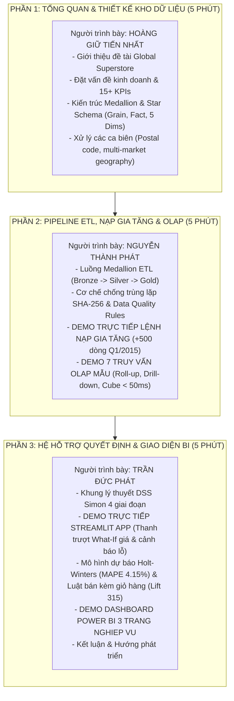

# KẾ HOẠCH SLIDE THUYẾT TRÌNH & QUAY VIDEO DEMO NỘP BÀI
## PHÂN HỆ THUYẾT TRÌNH & BÀN GIAO - CO4031 (HK261)
**Phụ trách:** Nguyễn Thành Phát (Lead Designer) & Cả nhóm

---

## 1. QUY ĐỊNH BẮT BUỘC CỦA BỘ MÔN

- **Hình thức nộp bài:** File nén `.zip` nộp lên hệ thống BKeL trước **23:59 Chủ Nhật, ngày 15/11/2026**.
- **Yêu cầu Video:** Độ dài từ **10 – 15 phút**, đăng tải lên YouTube (chế độ Unlisted) hoặc Google Drive mở quyền truy cập cho giảng viên.
- **Quy định thuyết trình:** **Tất cả 3 thành viên trong nhóm đều bắt buộc phải xuất hiện trong video và trực tiếp trình bày phần việc của mình**. Không chấp nhận trường hợp chỉ có 1 người nói toàn bộ video.

---

## 2. PHÂN CHIA THỜI LƯỢNG VÀ KỊCH BẢN NÓI (15 PHÚT)

---

## 3. CẤU TRÚC CHI TIẾT 20 SLIDES THUYẾT TRÌNH

| Slide | Tiêu đề Slide | Nội dung trọng tâm | Minh chứng trực quan |
|:---:|---|---|---|
| **1** | Trang tiêu đề | Tên đề tài, Trường/Khoa, GVHD Đỗ Thanh Thái, Danh sách 3 SV. | Logo Bách Khoa chính thức. |
| **2** | Bối cảnh doanh nghiệp Global Superstore | Quy mô 51k đơn hàng, 147 quốc gia, nghịch lý "bán nhiều nhưng lỗ nặng". | Bản đồ các thị trường toàn cầu. |
| **3** | Hệ thống 15+ KPIs cốt lõi | Phân loại chỉ số Sales, Product, Customer và công thức toán học. | Bảng ma trận KPI chuẩn. |
| **4** | Kiến trúc Tổng thể Hệ sinh thái | Mô hình phân tầng: Nguồn $\to$ Medallion DW $\to$ OLAP/DSS $\to$ UI (Power BI & Streamlit). | Sơ đồ kiến trúc phân lớp. |
| **5** | Thiết kế Star Schema & Xác định Grain | Grain 1 dòng đơn hàng, 1 Fact trung tâm, 5 Dimensions chuẩn Kimball. | Sơ đồ quan hệ Star Schema. |
| **6** | Giải pháp Kỹ thuật Xử lý Dữ liệu đặc thù | Imputation Postal Code, xử lý ngày hỗn hợp, UNIQUE đa trường cho địa lý. | Bảng so sánh trước và sau làm sạch. |
| **7** | Tầng Bronze: Ingestion Audit & Checksum | Mã băm SHA-256, bảng lưu vết `bronze.ingestion`, cơ chế Idempotency. | Ảnh chụp bảng audit và log check trùng. |
| **8** | Tầng Silver: Làm sạch & Kiểm định dữ liệu | Chuẩn hóa kiểu dữ liệu, gán cờ hoàn trả, bộ kiểm tra chất lượng tự động. | Kết quả chạy `silver/validate.py`. |
| **9** | Tầng Gold & Đối soát Tài chính tuyệt đối | Lookup surrogate keys, đối soát khớp 100% doanh thu và lợi nhuận. | Bảng đối soát $12.64M Sales, $1.47M Profit. |
| **10** | Demo Nạp gia tăng (Incremental Loading) | Cơ chế Change Data Capture (CDC), nạp bổ sung 500 dòng đơn hàng năm 2015. | Ảnh chụp lệnh `demo_incremental.py`. |
| **11** | Khai thác OLAP Đa chiều (Phần 1) | Thao tác Roll-up tổng hợp cấp cao và Drill-down khoan sâu SKU lỗ nặng. | Bảng kết quả Roll-up & Drill-down SQL. |
| **12** | Khai thác OLAP Đa chiều (Phần 2) | Thao tác Slice & Dice, Pivot 4 quý, Window Function MoM & DENSE_RANK. | Bảng ma trận Pivot & Rank Top 5. |
| **13** | Tối ưu Hiệu năng với Materialized Views | 3 Materialized Views tầng Gold, thời gian phản hồi truy vấn dưới 50ms. | Biểu đồ so sánh thời gian Explain Analyze. |
| **14** | Khung lý thuyết DSS & Chu trình Herbert Simon | 4 giai đoạn: Intelligence $\to$ Design $\to$ Choice $\to$ Implementation. | Sơ đồ luồng quyết định 4 bước. |
| **15** | Mô hình Mô phỏng What-If (Discount & Profit) | Công thức toán độ co giãn cầu $e$, mô phỏng điều chỉnh chiết khấu và khuyến nghị. | Công thức toán và bộ quy tắc Approve/Reject. |
| **16** | Mô hình Dự báo Doanh số Chuỗi thời gian | Thuật toán Holt-Winters, sai số MAPE 4.15%, dải tin cậy 95% cho 6 tháng tới. | Biểu đồ đường dự báo doanh số. |
| **17** | Khai phá Luật kết hợp Giỏ hàng (Market Basket) | Thuật toán Apriori, chỉ số Support, Confidence, Lift tới 315, gợi ý bán chéo. | Bảng top các cặp sản phẩm bán kèm mạnh nhất. |
| **18** | Demo Giao diện Web Tương tác DSS (Streamlit) | Trực tiếp kéo slider What-if, quan sát biểu đồ biến thiên lợi nhuận tức thời. | Ảnh chụp 4 tab giao diện Streamlit. |
| **19** | Demo Dashboard Power BI Chuyên nghiệp | 3 trang báo cáo chuẩn doanh nghiệp (Executive, Product Pareto, Customer RFM). | Ảnh chụp 3 trang dashboard `.pbix`. |
| **20** | Kết luận, Chuẩn đầu ra & Phiên Q&A | Đối chiếu đáp ứng 100% chuẩn đầu ra môn học, cảm ơn Thầy và mở phiên Q&A. | Bảng ma trận L.O và thông tin liên hệ. |

---

## 4. CHECKLIST ĐÓNG GÓI & NỘP BÀI (DEADLINE: 15/11/2026)

- [ ] File báo cáo toàn văn: `reports/Bao_Cao_BTL_CO4031_NhomXX.pdf` (Đầy đủ trang bìa, tỷ lệ đóng góp, link video YouTube).
- [ ] File slide thuyết trình: `slides/Slide_Thuyet_Trinh_CO4031_NhomXX.pptx` hoặc `.pdf`.
- [ ] File dashboard Power BI: `reports/Global_Superstore_BI.pbix`.
- [ ] Mã nguồn dự án: Toàn bộ thư mục source code, Docker Compose, script SQL, pipeline ETL, module DSS, Streamlit app.
- [ ] Đóng gói toàn bộ vào file `.zip` theo định dạng: `CO4031_NhomXX_BTL.zip` và upload lên BKeL trước hạn chót.
