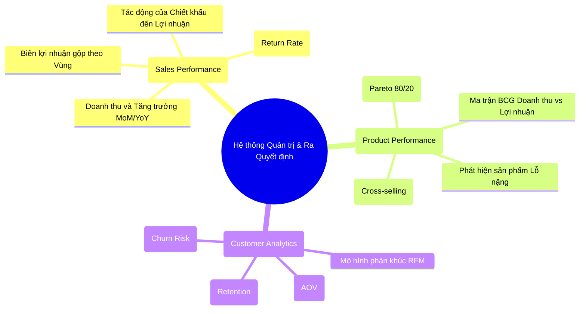

# SSOT 01: PHÂN TÍCH NGHIỆP VỤ & TỪ ĐIỂN CHỈ SỐ KPI (BUSINESS ANALYSIS & KPI DICTIONARY)

> **Mã tài liệu:** SSOT-01  
> **Phiên bản:** 1.0  
> **Trạng thái:** Chính thức (Approved)  
> **Người biên soạn:** Tiến Nhất (Data Architect)

---

## 1. BỐI CẢNH VÀ BÀI TOÁN KINH DOANH (BUSINESS CONTEXT)

**Global Superstore** là một tập đoàn bán lẻ thương mại điện tử đa quốc gia quy mô lớn, kinh doanh hàng ngàn mã sản phẩm (SKU) thuộc 3 ngành hàng chính:
1. **Furniture (Nội thất):** Bàn làm việc, ghế, giá sách, bàn ghế văn phòng.
2. **Office Supplies (Thiết bị & Văn phòng phẩm):** Giấy, bút chì, kẹp ghim, bìa hồ sơ, máy tính xách tay nhỏ.
3. **Technology (Công nghệ):** Máy in, máy photocopy, điện thoại, phụ kiện công nghệ cao.

Hoạt động bán hàng phủ rộng trên **147 quốc gia**, chia thành **7 thị trường (Markets)** lớn (*Africa, APAC, Canada, EMEA, EU, LATAM, US*) và **13 phân vùng địa lý (Regions)**.

### Thách thức quản trị thực tế của Global Superstore:
- **Tăng trưởng ảo do Chiết khấu (Discounting Paradox):** Nhiều khu vực ghi nhận doanh thu rất cao nhưng lợi nhuận thực tế bị âm do áp dụng chiết khấu sâu (lên đến 50% - 85%), cộng với chi phí giao vận quốc tế (`Shipping Cost`) cao.
- **Tồn dư danh mục kém hiệu quả:** Một số sản phẩm có số lượng bán (`Quantity`) rất lớn nhưng đem lại biên lợi nhuận âm (bán càng nhiều càng lỗ).
- **Hành vi khách hàng phân hóa sâu sắc:** Khách hàng bao gồm 3 phân khúc (*Consumer, Corporate, Home Office*) với tần suất mua hàng, chu kỳ tái mua và độ nhạy cảm về giá rất khác nhau.
- **Rủi ro đứt gãy chuỗi cung ứng và dự báo:** Thiếu công cụ dự báo doanh số và nhu cầu theo tháng dẫn đến bị động trong việc phân bổ ngân sách tồn kho và kế hoạch nhập hàng.

---

## 2. BA TRỌNG TÂM NGHIỆP VỤ (3 CORE BUSINESS DOMAINS)

---

## 3. TỪ ĐIỂN CHỈ SỐ KPI CHI TIẾT (KPI SPECIFICATION DICTIONARY)

Dưới đây là bộ chỉ số định lượng bắt buộc được tích hợp xuyên suốt từ tầng Kho dữ liệu Gold, qua các câu truy vấn OLAP, tới Dashboard BI và hệ DSS.

### 3.1. Nhóm chỉ số Hiệu quả Kinh doanh (Sales Performance KPIs)

| Mã KPI | Tên chỉ số | Công thức tính toán | Đơn vị | Ý nghĩa & Ngưỡng quản trị |
|---|---|---|:---:|---|
| **KPI-S01** | **Tổng Doanh thu (Gross Sales)** | $$\text{Sales} = \sum \text{Line\_Sales}$$ | USD (\$) | Thước đo quy mô dòng tiền bán hàng gộp. Theo dõi theo ngày, tháng, quý, năm. |
| **KPI-S02** | **Tổng Lợi nhuận ròng (Net Profit)** | $$\text{Profit} = \sum \text{Line\_Profit}$$ | USD (\$) | Thước đo hiệu quả sinh lời cốt lõi sau khi trừ giá vốn, chiết khấu và phí vận chuyển. |
| **KPI-S03** | **Biên Lợi nhuận (Profit Margin %)** | $$\text{Profit Margin} = \frac{\sum \text{Profit}}{\sum \text{Sales}} \times 100\%$$ | % | **Ngưỡng an toàn:** $\ge 12\%$. **Cảnh báo vàng:** $5\% - 12\%$. **Báo động đỏ:** $< 0\%$ (Kinh doanh lỗ ròng). |
| **KPI-S04** | **Tỷ lệ Chiết khấu Bình quân (Avg Discount)** | $$\text{Avg Discount} = \frac{\sum (\text{Discount} \times \text{Sales})}{\sum \text{Sales}}$$ | % | Tỷ lệ giảm giá trọng số theo doanh thu. Nếu $> 20\%$, nguy cơ xói mòn lợi nhuận nghiêm trọng. |
| **KPI-S05** | **Tăng trưởng Doanh thu theo tháng (MoM Growth %)** | $$\text{MoM Growth} = \frac{\text{Sales}_t - \text{Sales}_{t-1}}{\text{Sales}_{t-1}} \times 100\%$$ | % | Theo dõi tốc độ mở rộng quy mô kinh doanh theo chu kỳ tháng. |
| **KPI-S06** | **Tỷ lệ Hoàn trả Đơn hàng (Return Rate %)** | $$\text{Return Rate} = \frac{\text{Count}(\text{Returned Orders})}{\text{Total Orders}} \times 100\%$$ | % | **Ngưỡng chấp nhận:** $\le 3\%$. Nếu $> 5\%$, cảnh báo chất lượng giao vận hoặc mô tả sản phẩm sai lệch. |
| **KPI-S07** | **Chi phí Vận chuyển trên Doanh thu (Shipping-to-Sales %)** | $$\text{Shipping Ratio} = \frac{\sum \text{Shipping Cost}}{\sum \text{Sales}} \times 100\%$$ | % | Đánh giá gánh nặng logistics. Ngưỡng bình thường: $8\% - 11\%$. |

### 3.2. Nhóm chỉ số Hiệu quả Sản phẩm (Product Performance KPIs)

| Mã KPI | Tên chỉ số | Công thức tính toán | Đơn vị | Ý nghĩa & Ngưỡng quản trị |
|---|---|---|:---:|---|
| **KPI-P01** | **Số lượng Sản phẩm bán ra (Units Sold)** | $$\text{Units} = \sum \text{Quantity}$$ | Sản phẩm | Đo lường khối lượng hàng hóa vận hành qua kho bãi. |
| **KPI-P02** | **Giá bán Bình quân mỗi đơn vị (Average Price per Unit)** | $$\text{Avg Price} = \frac{\sum \text{Sales}}{\sum \text{Quantity}}$$ | USD/sp | Giá bán thực tế trung bình của sản phẩm sau giảm giá. |
| **KPI-P03** | **Tỷ trọng Đóng góp Doanh số (Sales Contribution %)** | $$\text{Contribution} = \frac{\text{Sales}_{\text{Category}}}{\text{Total Sales}} \times 100\%$$ | % | Đánh giá danh mục chủ lực (Core categories). |
| **KPI-P04** | **Chỉ số Lợi nhuận trên Đơn vị (Unit Profitability)** | $$\text{Unit Profit} = \frac{\sum \text{Profit}}{\sum \text{Quantity}}$$ | USD/sp | Mức lãi gộp trên 1 sản phẩm bán ra. Sản phẩm có giá trị âm cần đưa vào danh sách kiểm soát đặc biệt. |
| **KPI-P05** | **Phân hạng Pareto ABC (ABC Classification)** | Nhóm A: 80% Doanh thu tích lũy Nhóm B: 15% tiếp theo Nhóm C: 5% cuối cùng | Phân lớp (A/B/C) | Tập trung 80% nguồn lực quản lý và tồn kho cho nhóm A. Giảm thiểu chiết khấu với nhóm C. |

### 3.3. Nhóm chỉ số Phân tích Khách hàng (Customer Analytics KPIs)

| Mã KPI | Tên chỉ số | Công thức tính toán | Đơn vị | Ý nghĩa & Ngưỡng quản trị |
|---|---|---|:---:|---|
| **KPI-C01** | **Giá trị Trung bình Đơn hàng (AOV - Average Order Value)** | $$\text{AOV} = \frac{\text{Total Sales}}{\text{Total Distinct Orders}}$$ | USD/đơn | Đo lường độ lớn của một giỏ hàng. Cần tối ưu cross-selling để nâng cao chỉ số này. |
| **KPI-C02** | **Tần suất Mua hàng Bình quân (Purchase Frequency)** | $$\text{Frequency} = \frac{\text{Total Orders}}{\text{Total Unique Customers}}$$ | Đơn/người | Mức độ tương tác và thói quen mua sắm của tập khách hàng. |
| **KPI-C03** | **Điểm Recency (R-Score)** | Số ngày tính từ lần mua gần nhất tới mốc phân tích: $\text{Recency} = T_{\text{current}} - \max(T_{\text{order}})$ | Ngày | Khách hàng có Recency $\le 60$ ngày được coi là khách hàng đang hoạt động tích cực (Active). |
| **KPI-C04** | **Phân khúc RFM Khách hàng** | Tổng hợp điểm quy chuẩn $R (1-5), F (1-5), M (1-5)$ | Phân hạng | Chia thành các nhóm: *Champions*, *Loyal Customers*, *Potential Loyalists*, *At Risk*, *Lost*. |

---

## 4. MA TRẬN ÁNH XẠ CÂU HỎI NGHIỆP VỤ VÀO ĐỐI TƯỢNG DATA WAREHOUSE & DSS

| ID | Câu hỏi nghiệp vụ | Đối tượng phân tích | Bảng DW tham gia | Thành phần DSS hỗ trợ |
|:---:|---|---|---|---|
| **S01** | Doanh thu & lợi nhuận thay đổi thế nào theo thời gian? | Xu hướng tài chính | `fact_sales`, `dim_date` | Sales Forecasting (Time Series) |
| **S03** | Quốc gia / thành phố nào có doanh số cao nhất / thấp nhất? | Phân tích địa lý | `fact_sales`, `dim_geography` | Geographic Ranking / Drill-down |
| **S04** | Khu vực nào doanh thu cao nhưng lợi nhuận âm? | Cảnh báo thất thoát | `fact_sales`, `dim_geography` | Risk Detection / Margin Alert |
| **S06** | Mức chiết khấu ảnh hưởng thế nào tới lợi nhuận? | Chiến lược giá | `fact_sales` | **What-if Discount Simulation** |
| **P03** | Sản phẩm nào bán chạy nhưng biên lợi nhuận âm? | Đánh giá danh mục | `fact_sales`, `dim_product` | Product Portfolio Matrix (BCG) |
| **P07** | Những sản phẩm nào thường được mua cùng nhau? | Hành vi mua sắm | `fact_sales`, `dim_product` | **Market Basket Analysis (Apriori)** |
| **C01** | Khách hàng nào đem lại doanh thu & lợi nhuận lớn nhất? | Định giá khách hàng | `fact_sales`, `dim_customer` | Pareto 80/20 Top Customers |
| **C07** | Khách hàng nào có dấu hiệu giảm tần suất mua hàng? | Rủi ro rời bỏ | `fact_sales`, `dim_customer`, `dim_date` | RFM Recency Churn Alert |

---

## 5. KẾT LUẬN & ĐỊNH HƯỚNG RA QUYẾT ĐỊNH
Bộ KPI và ma trận câu hỏi trên cung cấp đầy đủ thông tin đa chiều để nhà quản trị không chỉ "nhìn thấy quá khứ" (Descriptive Analytics qua OLAP & Power BI) mà còn "dự báo tương lai và mô phỏng hành động" (Predictive & Prescriptive Analytics qua DSS).
