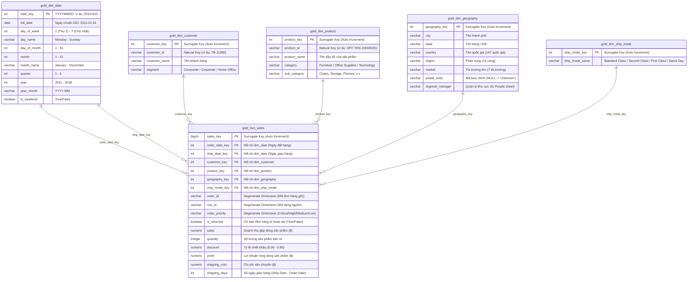

# SSOT 02: KIẾN TRÚC DỮ LIỆU & THIẾT KẾ MÔ HÌNH HÌNH SAO (STAR SCHEMA SPECIFICATION)

> **Mã tài liệu:** SSOT-02  
> **Phiên bản:** 1.0  
> **Trạng thái:** Chính thức (Approved)  
> **Người biên soạn:** Tiến Nhất (Data Architect)

---

## 1. TỔNG QUAN KIẾN TRÚC PHÂN TẦNG MEDALLION (MEDALLION ARCHITECTURE)

Kho dữ liệu Global Superstore được tổ chức theo kiến trúc phân tầng chuẩn công nghiệp (Medallion Architecture) gồm 3 tầng dữ liệu cốt lõi và 1 tầng chuyên biệt cho DSS:

```text
+---------------------------------------------------------------------------------------+
|                                    DATA SOURCES                                       |
|                  Global Superstore.xls (Orders, Returns, People)                      |
|                  Sample - Superstore.csv (Incremental Test Data)                      |
+-------------------------------------------+-------------------------------------------+
                                            |
                                            v
+---------------------------------------------------------------------------------------+
| 1. BRONZE LAYER (Raw Ingestion):                                                      |
|    - Schema: bronze                                                                   |
|    - bronze.ingestion: Lưu vết nguồn file, hash SHA-256, thời điểm nạp, metadata.     |
|    - bronze.raw_orders: Lưu nguyên trạng dữ liệu nguồn, toàn bộ kiểu TEXT.            |
|    - bronze.market, bronze.postal_code: Lưu vết ánh xạ địa lý nguồn.                  |
+-------------------------------------------+-------------------------------------------+
                                            |
                                            v
+---------------------------------------------------------------------------------------+
| 2. SILVER LAYER (Cleaned & Standardized):                                             |
|    - Schema: silver                                                                   |
|    - silver.orders: Chuẩn hóa kiểu dữ liệu (Date, Numeric, Integer, Text).            |
|    - Xử lý Date đa định dạng (d/m/Y, d-m-Y -> DATE). Xử lý Postal Code NULL (80.5%).  |
|    - Tích hợp cờ hoàn trả (is_returned từ Returns) & Quản lý vùng (từ People).        |
|    - Giữ nguyên Grain giao dịch gốc (1 dòng đơn hàng = 1 row).                        |
+-------------------------------------------+-------------------------------------------+
                                            |
                                            v
+---------------------------------------------------------------------------------------+
| 3. GOLD LAYER (Dimensional Star Schema & Data Marts):                                 |
|    - Schema: gold                                                                     |
|    - Star Schema: FactSales nối với 5 DimTables bằng Khóa thay thế (Surrogate Keys).  |
|    - Data Marts (Materialized Views): mv_sales_mart, mv_product_mart, mv_customer_mart|
+-------------------------------------------+-------------------------------------------+
                                            |
                                            v
+---------------------------------------------------------------------------------------+
| 4. DSS SCHEMA (Decision Support System Engine):                                       |
|    - Schema: dss                                                                      |
|    - dss.forecast_run, dss.forecast_result: Lưu kết quả dự báo doanh thu & nhu cầu.   |
|    - dss.association_run, dss.association_rule: Lưu luật kết hợp (Apriori/FP-Growth). |
+---------------------------------------------------------------------------------------+
```

---

## 2. XÁC ĐỊNH GRAIN (MỨC ĐỘ CHI TIẾT CỦA BẢNG FACT)

Theo nguyên lý thiết kế của Ralph Kimball, bước quan trọng nhất trong Dimensional Modeling là xác định Grain:
- **Grain của FactSales:**  
  $$\text{Grain} = \mathbf{Một\ dòng\ sản\ phẩm\ cụ\ thể\ nằm\ trong\ một\ đơn\ hàng\ bán\ lẻ}$$
- **Tính duy nhất của Grain:** Được định danh bằng thuộc tính `row_id` từ hệ thống nguồn, hoặc tổ hợp tự nhiên `(order_id, product_id)`.
- **Lý do lựa chọn Grain chi tiết nhất (Atomic Grain):**
  1. Cho phép **Drill-down** tới mức giao dịch sâu nhất không bị mất mát thông tin.
  2. Cung cấp dữ liệu đầu vào cho bài toán **Association Rule Mining** (Khai phá giỏ hàng yêu cầu phải biết chính xác các sản phẩm nào cùng xuất hiện trong một mã đơn hàng `order_id`).
  3. Linh hoạt tổng hợp (Roll-up) theo bất kỳ chiều phân tích nào (Thời gian, Khách hàng, Địa lý, Sản phẩm, Phương thức vận chuyển).

---

## 3. SƠ ĐỒ MÔ HÌNH HÌNH SAO (STAR SCHEMA ER DIAGRAM)



---

## 4. CHI TIẾT CÁC BẢNG TRONG MÔ HÌNH SAO

### 4.1. Bảng Fact Trung tâm: `gold.fact_sales`
- **Mục đích:** Lưu trữ các độ đo (measures) số học về hoạt động bán hàng ở mức chi tiết nhất.
- **Phân loại độ đo:**
  - **Additive Measures (Cộng gộp hoàn toàn):**
    - `sales`: Có thể cộng theo bất kỳ chiều nào (thời gian, khách hàng, sản phẩm, địa lý).
    - `quantity`: Số sản phẩm bán ra.
    - `profit`: Lợi nhuận ròng (lưu ý giá trị có thể âm).
    - `shipping_cost`: Chi phí vận chuyển.
  - **Non-additive / Rate Measures (Không cộng gộp trực tiếp):**
    - `discount`: Là tỷ lệ phần trăm ($0.0 - 0.85$). Muốn tính chiết khấu bình quân phải dùng trung bình gia quyền:
      $$\text{Avg Discount} = \frac{\sum (\text{discount} \times \text{sales})}{\sum \text{sales}}$$
  - **Calculated Metric:**
    - `shipping_days = ship_date - order_date`: Thời gian hoàn tất giao vận (Lead time).
  - **Degenerate Dimensions (Chiều thoái hóa):**
    - `order_id`: Giữ lại để phục vụ phân tích giỏ hàng (Market Basket Analysis), gom đơn và đối chiếu nghiệp vụ.
    - `row_id`: Giữ lại làm trace ngược về dòng nguồn.
    - `order_priority`: Mức độ ưu tiên đơn hàng (`Critical`, `High`, `Medium`, `Low`).
  - **Status Flag:**
    - `is_returned`: Giá trị Boolean (`TRUE` nếu `order_id` xuất hiện trong bảng `Returns`, ngược lại `FALSE`).

### 4.2. Bảng Chiều: `gold.dim_date` (Role-Playing Dimension)
- **Đặc điểm:** Một bảng chiều duy nhất nhưng đóng 2 vai trò khác nhau trong `fact_sales`:
  1. `order_date_key`: Phân tích theo thời điểm phát sinh đơn hàng (Doanh thu bán hàng).
  2. `ship_date_key`: Phân tích theo thời điểm giao hàng (Hiệu suất logistics).
- **Khóa chính:** `date_key` kiểu số nguyên định dạng `YYYYMMDD` (Ví dụ: `20110115`), hỗ trợ partitioning và indexing cực nhanh trong PostgreSQL.
- **Dữ liệu:** Được sinh tự động từ ngày `2011-01-01` đến `2018-12-31` (Đảm bảo bao phủ cả tập dữ liệu 51k gốc và tập nạp tăng trưởng 10k).

### 4.3. Bảng Chiều: `gold.dim_customer`
- **Khóa thay thế (Surrogate Key):** `customer_key` (SERIAL / IDENTITY).
- **Khóa tự nhiên (Natural Key):** `customer_id` (Ví dụ: `TB-11280`).
- **Thuộc tính:** `customer_name`, `segment` (`Consumer`, `Corporate`, `Home Office`).
- **Chiến lược SCD (Slowly Changing Dimensions):** Sử dụng **SCD Type 1** (ghi đè thông tin mới nhất) do đề bài không yêu cầu theo dõi lịch sử thay đổi phân khúc của khách hàng.

### 4.4. Bảng Chiều: `gold.dim_product`
- **Khóa thay thế (Surrogate Key):** `product_key` (SERIAL).
- **Khóa tự nhiên (Natural Key):** `product_id` (Ví dụ: `OFF-TEN-10000025`).
- **Thuộc tính:** `product_name`, `category` (3 danh mục), `sub_category` (17 nhóm hàng).
- **Xử lý đặc thù:** Trong dữ liệu thực tế, một `product_id` có thể gắn với tên sản phẩm có sự chênh lệch nhỏ về chuỗi ký tự giữa các vùng; quy trình Silver sẽ chuẩn hóa và chọn bản ghi chuẩn nhất theo `product_id`.

### 4.5. Bảng Chiều: `gold.dim_geography`
- **Khóa thay thế (Surrogate Key):** `geography_key` (SERIAL).
- **Cấu trúc phân cấp địa lý (Hierarchy):**  
  $$\text{Market} \longrightarrow \text{Region} \longrightarrow \text{Country} \longrightarrow \text{State} \longrightarrow \text{City}$$
- **Xử lý thuộc tính `postal_code`:**
  - Trong bộ dữ liệu gốc `Global Superstore`, cột `Postal Code` bị **NULL tới 80.5%** (chỉ có đơn hàng tại Mỹ mới có Postal Code).
  - **Giải pháp chuẩn hóa:** Nếu `Postal Code` rỗng hoặc NULL, gán giá trị mặc định là `'Unknown'`. Khóa tự nhiên của địa lý được xác định bởi tổ hợp: `(country, state, city, COALESCE(postal_code, 'Unknown'))`.
- **Tích hợp Quản lý vùng (`regional_manager`):** Nối dữ liệu từ Sheet `People` theo `Region` để gán tên Giám đốc khu vực phục vụ báo cáo hiệu quả nhân sự.

### 4.6. Bảng Chiều: `gold.dim_ship_mode`
- **Khóa thay thế (Surrogate Key):** `ship_mode_key` (SERIAL).
- **Các giá trị chuẩn:** `Standard Class`, `Second Class`, `First Class`, `Same Day`.

---

## 5. THIẾT KẾ CÁC DATA MARTS PHỤC VỤ TRUY VẤN TỐC ĐỘ CAO (MATERIALIZED VIEWS)

Để tối ưu hóa hiệu năng cho Power BI và DSS Web App, 3 Materialized Views được tạo dựng trực tiếp trên các bảng Gold:

1. **`gold.mv_sales_mart`:** Tổng hợp doanh thu, lợi nhuận, chiết khấu bình quân, số lượng đơn hàng theo Năm, Quý, Tháng, Thị trường, Vùng và Phân khúc khách hàng.
2. **`gold.mv_product_mart`:** Tổng hợp doanh thu, lợi nhuận, số lượng bán, biên lợi nhuận, giá bán bình quân theo Danh mục (`category`), Phân nhóm (`sub_category`), và Từng sản phẩm.
3. **`gold.mv_customer_mart`:** Tính toán các chỉ số RFM (Recency, Frequency, Monetary), AOV, và ngày mua gần nhất của từng khách hàng.
