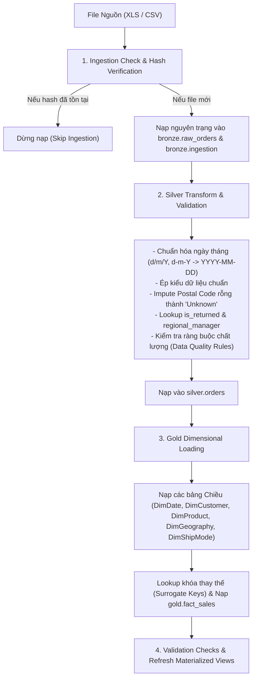

# SSOT 03: ĐẶC TẢ QUY TRÌNH ETL PHÂN TẦNG MEDALLION (ETL PIPELINE SPECIFICATION)

> **Mã tài liệu:** SSOT-03  
> **Phiên bản:** 1.0  
> **Trạng thái:** Chính thức (Approved)  
> **Người biên soạn:** Tiến Nhất & Thành Phát

---

## 1. TỔNG QUAN QUY TRÌNH ETL

Quy trình ETL (Extract - Transform - Load) được thiết kế theo nguyên tắc:
1. **Idempotent (Tính khả lặp):** Chạy lại nhiều lần không làm sai lệch hay nhân đôi dữ liệu.
2. **Auditability (Khả năng lưu vết):** Mọi lần nạp đều được ghi lại nguồn file, thời gian, số dòng, hash SHA-256 vào `bronze.ingestion`.
3. **Fail-safe & Transactional:** Sử dụng transaction database; nếu có lỗi xảy ra ở bất kỳ bảng con nào, toàn bộ transaction của batch đó sẽ tự động rollback.



---

## 2. ĐẶC TẢ TẦNG BRONZE (RAW INGESTION LAYER)

### 2.1. Bảng lưu vết: `bronze.ingestion`
Lưu trữ thông tin metadata của mọi file dữ liệu được nạp vào hệ thống:
```sql
CREATE TABLE IF NOT EXISTS bronze.ingestion (
    id SERIAL PRIMARY KEY,
    source_name TEXT NOT NULL,
    content_hash TEXT NOT NULL UNIQUE,
    loaded_time TIMESTAMP NOT NULL DEFAULT CURRENT_TIMESTAMP,
    metadata JSONB
);
```

### 2.2. Kiểm tra tính toàn vẹn và chống nạp trùng lặp:
Trước khi đọc dữ liệu, hệ thống tính toán giá trị băm **SHA-256** của toàn bộ nội dung file (`content_hash`):
```sql
SELECT EXISTS (
    SELECT 1 FROM bronze.ingestion WHERE content_hash = :content_hash
) AS exists;
```
- Nếu `exists = TRUE`: Hệ thống ghi log cảnh báo `"File already ingested. Skipping."` và dừng pipeline.
- Nếu `exists = FALSE`: Tiến hành nạp dữ liệu.

### 2.3. Bảng dữ liệu thô: `bronze.raw_orders`
Lưu trữ nguyên trạng mọi cột trong file nguồn, toàn bộ kiểu `TEXT` để tránh rủi ro parse lỗi tại tầng Bronze:
- Cột bổ sung: `ingestion INTEGER REFERENCES bronze.ingestion(id)`, `transform BOOLEAN DEFAULT FALSE`.

---

## 3. ĐẶC TẢ TẦNG SILVER (CLEANING, STANDARDIZATION & CONFORMATION)

Mục tiêu của tầng Silver là biến đổi dữ liệu thô từ `bronze.raw_orders` thành bảng `silver.orders` sạch, có kiểu dữ liệu chuẩn và kiểm tra chất lượng chặt chẽ.

### 3.1. Các quy tắc chuyển đổi và làm sạch cốt lõi:

| Cột dữ liệu | Vấn đề ở tầng Bronze | Quy tắc xử lý tại Silver | Kiểu dữ liệu Silver |
|---|---|---|:---:|
| `Row ID` | Kiểu Text | Chuyển thành số nguyên `INTEGER`, làm khóa tự nhiên duy nhất. | `INTEGER` |
| `Order ID` | Text, định dạng mã đơn hàng | Cắt khoảng trắng (TRIM), giữ nguyên định dạng. | `VARCHAR(50)` |
| `Order Date`, `Ship Date` | Định dạng hỗn hợp: lúc `d/m/Y`, lúc `d-m-Y` | Dùng logic parse ngày hỗn hợp chuẩn ISO `YYYY-MM-DD`. Kiểm tra ràng buộc: `ship_date >= order_date`. | `DATE` |
| `Ship Mode` | Text | Chuẩn hóa TRIM, kiểm tra thuộc tập hợp: `{'Standard Class', 'Second Class', 'First Class', 'Same Day'}`. | `VARCHAR(50)` |
| `Customer ID` | Text | Chuẩn hóa TRIM, làm khóa tự nhiên khách hàng. | `VARCHAR(50)` |
| `Postal Code` | **80.5% bản ghi bị NULL** | Nếu NULL hoặc rỗng -> Gán chuỗi `'Unknown'`. | `VARCHAR(20)` |
| `Sales` | Text (chứa dấu phẩy, khoảng trắng) | Ép kiểu `NUMERIC(12, 4)`. Kiểm tra `sales >= 0`. | `NUMERIC(12, 4)` |
| `Quantity` | Text | Ép kiểu `INTEGER`. Kiểm tra `quantity > 0`. | `INTEGER` |
| `Discount` | Text (0.0 đến 0.85) | Ép kiểu `NUMERIC(5, 4)`. Kiểm tra `0 <= discount <= 1.0`. | `NUMERIC(5, 4)` |
| `Profit` | Text | Ép kiểu `NUMERIC(12, 4)` (Cho phép giá trị âm). | `NUMERIC(12, 4)` |
| `Shipping Cost` | Text | Ép kiểu `NUMERIC(12, 4)`. Kiểm tra `shipping_cost >= 0`. | `NUMERIC(12, 4)` |
| `is_returned` | Không có sẵn trong file Orders | Tự động LEFT JOIN với sheet `Returns` theo `order_id`: Nếu có trả hàng -> `TRUE`, ngược lại `FALSE`. | `BOOLEAN` |
| `regional_manager` | Không có sẵn trong file Orders | Tự động LEFT JOIN với sheet `People` theo `Region` để gán tên Trưởng khu vực. | `VARCHAR(100)` |

### 3.2. Bộ kiểm tra chất lượng dữ liệu (Data Quality Checks - Silver Validation):
Sau khi chuyển đổi vào Silver, hệ thống thực thi 3 script SQL kiểm tra:
1. `check_nulls.sql`: Đảm bảo các cột bắt buộc (`row_id`, `order_id`, `order_date`, `customer_id`, `product_id`, `sales`, `quantity`) có tỷ lệ NULL = 0%.
2. `check_duplicates.sql`: Đảm bảo `row_id` không có giá trị trùng lặp.
3. `check_data_quality.sql`:
   - Xác minh `ship_date >= order_date`.
   - Xác minh `sales >= 0`, `quantity > 0`, `discount BETWEEN 0 AND 1`.

---

## 4. ĐẶC TẢ TẦNG GOLD (DIMENSIONAL STAR SCHEMA LOADING)

Tầng Gold đọc dữ liệu đã làm sạch từ `silver.orders` để nạp vào mô hình Star Schema.

### 4.1. Thứ tự nạp dữ liệu (Loading Sequence):
Do ràng buộc khóa ngoại, thứ tự nạp bắt buộc phải là:
$$\mathbf{DimDate} \longrightarrow \mathbf{DimCustomer} \longrightarrow \mathbf{DimProduct} \longrightarrow \mathbf{DimGeography} \longrightarrow \mathbf{DimShipMode} \longrightarrow \mathbf{FactSales} \longrightarrow \mathbf{Materialized\ Views}$$

### 4.2. Logic nạp từng bảng chiều:
1. **`gold.dim_date`:**
   - Được sinh tự động từ chuỗi thời gian liên tục (`generate_series('2011-01-01'::date, '2018-12-31'::date, '1 day'::interval)`).
   - `date_key = CAST(TO_CHAR(d, 'YYYYMMDD') AS INTEGER)`.
2. **`gold.dim_customer`:**
   - `SELECT DISTINCT customer_id, customer_name, segment FROM silver.orders ON CONFLICT (customer_id) DO NOTHING`.
3. **`gold.dim_product`:**
   - `SELECT DISTINCT product_id, product_name, category, sub_category FROM silver.orders ON CONFLICT (product_id) DO NOTHING`.
4. **`gold.dim_geography`:**
   - `SELECT DISTINCT country, state, city, region, market, postal_code, regional_manager FROM silver.orders ON CONFLICT (country, state, city, postal_code) DO NOTHING`.
5. **`gold.dim_ship_mode`:**
   - `SELECT DISTINCT ship_mode FROM silver.orders ON CONFLICT (ship_mode_name) DO NOTHING`.

### 4.3. Logic nạp bảng Fact (`gold.fact_sales`):
Bảng Fact nạp bằng câu lệnh SQL JOIN giữa `silver.orders` và các bảng Dimension để lấy Surrogate Key:
```sql
INSERT INTO gold.fact_sales (
    order_date_key,
    ship_date_key,
    customer_key,
    product_key,
    geography_key,
    ship_mode_key,
    order_id,
    row_id,
    order_priority,
    is_returned,
    sales,
    quantity,
    discount,
    profit,
    shipping_cost,
    shipping_days
)
SELECT
    TO_CHAR(s.order_date, 'YYYYMMDD')::INTEGER AS order_date_key,
    TO_CHAR(s.ship_date, 'YYYYMMDD')::INTEGER AS ship_date_key,
    c.customer_key,
    p.product_key,
    g.geography_key,
    sm.ship_mode_key,
    s.order_id,
    s.row_id::TEXT,
    s.order_priority,
    s.is_returned,
    s.sales,
    s.quantity,
    s.discount,
    s.profit,
    s.shipping_cost,
    (s.ship_date - s.order_date) AS shipping_days
FROM silver.orders s
JOIN gold.dim_customer c ON s.customer_id = c.customer_id
JOIN gold.dim_product p ON s.product_id = p.product_id
JOIN gold.dim_geography g ON s.country = g.country 
    AND s.state = g.state 
    AND s.city = g.city 
    AND s.postal_code = g.postal_code
JOIN gold.dim_ship_mode sm ON s.ship_mode = sm.ship_mode_name
ON CONFLICT (row_id) DO NOTHING;
```

---

## 5. ĐẶC TẢ NẠP GIA TĂNG (INCREMENTAL LOAD SPECIFICATION)

Để đáp ứng yêu cầu của đồ án về việc kiểm thử nạp bổ sung dữ liệu mới (`Sample - Superstore.csv` ~10,000 bản ghi giai đoạn 2014–2018):
1. **Nhận diện bản ghi mới:** Dựa vào `row_id` và `content_hash`.
2. **Xử lý Dimension:** Sử dụng cú pháp `ON CONFLICT (...) DO UPDATE` hoặc `DO NOTHING` để bổ sung khách hàng, sản phẩm hoặc địa điểm mới xuất hiện trong đợt nạp gia tăng mà không làm hỏng surrogate keys cũ.
3. **Xử lý Fact:** Chỉ nạp các `row_id` chưa từng tồn tại trong `gold.fact_sales`.
4. **Làm mới Data Marts:** Chạy lệnh `REFRESH MATERIALIZED VIEW` để cập nhật số liệu tổng hợp ngay sau khi nạp gia tăng thành công.
