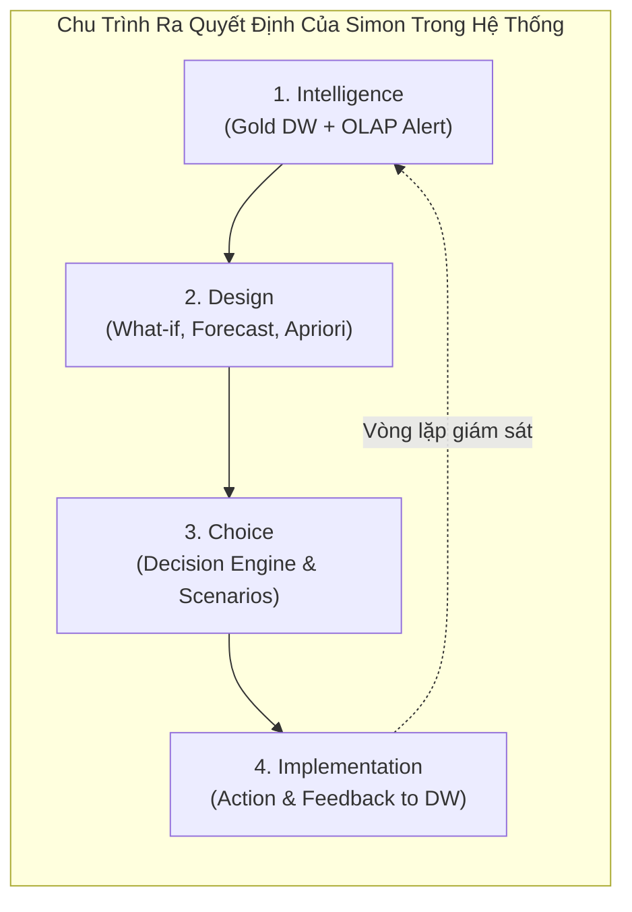

# SSOT 05: ĐẶC TẢ HỆ HỖ TRỢ QUYẾT ĐỊNH (DECISION SUPPORT SYSTEM SPECIFICATION)

> **Mã tài liệu:** SSOT-05  
> **Phiên bản:** 1.0  
> **Trạng thái:** Chính thức (Approved)  
> **Người biên soạn:** Tiến Nhất (Data Architect & DSS Lead)

---

## 1. KHUNG LÝ THUYẾT VỀ DSS (THEORETICAL FRAMEWORK)

Theo giáo trình kinh điển của **Efraim Turban** (*Decision Support Systems and Intelligent Systems*), một hệ hỗ trợ quyết định (DSS) là một hệ thống thông tin tương tác, dựa trên máy tính, được thiết kế để hỗ trợ các nhà quản trị giải quyết các **vấn đề bán cấu trúc (semi-structured)** hoặc **phi cấu trúc (unstructured)** bằng cách kết hợp dữ liệu, mô hình toán học và giao diện thân thiện.

### Chu trình 4 giai đoạn ra quyết định của Herbert Simon:
1. **Intelligence (Thu thập thông tin & Phát hiện vấn đề):**
   - *Thực hiện qua:* Kho dữ liệu Gold, OLAP Slice/Dice/Drill-down và Dashboard cảnh báo.
   - *Phát hiện:* Nhận diện khu vực hoặc ngành hàng có doanh số tăng nhưng lợi nhuận giảm mạnh; phát hiện sản phẩm có tỷ lệ hoàn trả cao; nhận diện khách hàng VIP có dấu hiệu ngừng mua hàng.
2. **Design (Thiết kế giải pháp & Xây dựng mô hình):**
   - *Thực hiện qua:* Các mô hình phân tích DSS tại `src/dss/`:
     - Mô hình mô phỏng **What-if Discount Analysis** (mô phỏng sự biến thiên của lợi nhuận khi thay đổi giá/chiết khấu).
     - Mô hình dự báo chuỗi thời gian **Sales & Demand Forecasting** (ước tính doanh số tương lai).
     - Mô hình khai phá luật kết hợp **Market Basket Analysis** (tìm kiếm cơ hội bán chéo).
3. **Choice (Lựa chọn phương án tối ưu):**
   - *Thực hiện qua:* Hệ thống đưa ra các kịch bản so sánh định lượng (Scenario comparison), tính toán biên an toàn và các khuyến nghị tự động (Recommendation Engine).
4. **Implementation (Thực thi & Đánh giá):**
   - Áp dụng chính sách giá mới, điều chỉnh tồn kho, kiểm tra phản hồi của thị trường qua chu kỳ nạp dữ liệu ETL tiếp theo.



---

## 2. BA THÀNH PHẦN DSS CỐT LÕI ĐƯỢC TRIỂN KHAI

### 2.1. Thành phần 1: Mô hình Mô phỏng What-If (What-If Discount & Profit Simulation)
- **Bài toán quản trị:** Ban giám đốc bán hàng thường chịu áp lực tăng doanh số nên có xu hướng tăng chiết khấu (Discount). Tuy nhiên, tăng chiết khấu có thể làm giảm biên lợi nhuận nghiêm trọng (bán nhiều nhưng lỗ).
- **Mục tiêu DSS:** Cho phép người dùng chọn một **Thị trường (Market)** hoặc **Ngành hàng (Category)**, điều chỉnh thanh trượt **Tỷ lệ chiết khấu thử nghiệm** ($\Delta d$), hệ thống lập tức tính toán tác động tới Doanh thu, Chi phí và Lợi nhuận mới.
- **Công thức mô phỏng:**
  - Giả định hệ số co giãn của cầu theo giá là $e$ (Price Elasticity of Demand, trong bán lẻ thông thường $e \approx 1.2 \sim 1.5$):
    $$\frac{\Delta Q}{Q} = e \times \frac{\Delta d}{1 - d_{\text{old}}}$$
  - Lượng bán mới dự kiến:
    $$Q_{\text{new}} = Q_{\text{old}} \times \left(1 + \frac{\Delta Q}{Q}\right)$$
  - Doanh thu mới:
    $$\text{Sales}_{\text{new}} = \text{Sales}_{\text{old}} \times \frac{1 - d_{\text{new}}}{1 - d_{\text{old}}} \times \left(1 + \frac{\Delta Q}{Q}\right)$$
  - Lợi nhuận mới dự kiến:
    $$\text{Profit}_{\text{new}} = \text{Sales}_{\text{new}} - \text{Total Cost} = \text{Sales}_{\text{new}} - (Q_{\text{new}} \times \text{Unit Cost} + \text{Shipping Cost}_{\text{new}})$$
- **Quy tắc khuyến nghị của hệ thống (Decision Rule):**
  - **Nếu $\text{Margin}_{\text{new}} < 5\%$:** Phát cảnh báo đỏ: *"Rủi ro biên lợi nhuận mỏng, không khuyến nghị áp dụng chiết khấu này."*
  - **Nếu $\text{Profit}_{\text{new}} < \text{Profit}_{\text{old}}$:** Phát cảnh báo cam: *"Tăng lượng bán không đủ bù đắp thâm hụt giá bán, lợi nhuận ròng giảm."*
  - **Nếu $\text{Profit}_{\text{new}} > \text{Profit}_{\text{old}}$ và $\text{Margin}_{\text{new}} \ge 12\%$:** Bật đèn xanh: *"Kịch bản khả thi, tăng trưởng cả quy mô và lợi nhuận tuyệt đối."*

---

### 2.2. Thành phần 2: Mô hình Dự báo Doanh thu Chuỗi Thời gian (Sales Forecasting)
- **Bài toán quản trị:** Dự báo trước doanh thu 3 đến 6 tháng tiếp theo để lập kế hoạch tài chính và nhập hàng.
- **Dữ liệu đầu vào:** Tổng hợp chuỗi thời gian doanh số theo tháng từ `gold.fact_sales` và `gold.dim_date` (48 tháng từ 2011 đến 2014):
  $$\{Y_t\}_{t=1}^{48} = \text{SUM}(\text{sales})$$
- **Mô hình triển khai:**
  1. *Baseline:* Naive (Lấy kỳ gần nhất) & Simple Moving Average (Kỳ 3 tháng).
  2. *Mô hình chính:* **Holt-Winters Exponential Smoothing** (bắt được xu hướng tăng trưởng Trend và tính mùa vụ Seasonality 12 tháng của bán lẻ).
- **Đánh giá sai số (Evaluation Metrics):**
  - $\text{MAE} = \frac{1}{n}\sum |y_t - \hat{y}_t|$ (Sai số tuyệt đối trung bình).
  - $\text{RMSE} = \sqrt{\frac{1}{n}\sum (y_t - \hat{y}_t)^2}$ (Phạt nặng sai số lớn).
  - $\text{MAPE} = \frac{100\%}{n}\sum \left|\frac{y_t - \hat{y}_t}{y_t}\right|$ (Sai số phần trăm).
- **Đầu ra:** Điểm dự báo trung tâm $\hat{y}_{t+h}$ kèm dải tin cậy 95% $[\text{Lower Bound}, \text{Upper Bound}]$.

---

### 2.3. Thành phần 3: Khai phá Giỏ hàng & Bán chéo (Association Rule Mining)
- **Bài toán quản trị:** Tối ưu hóa giá trị trung bình đơn hàng (AOV) bằng cách phát hiện các sản phẩm thường xuyên được khách hàng mua cùng lúc trong một đơn hàng.
- **Dữ liệu đầu vào:** Giao dịch ở grain dòng đơn hàng `(order_id, product_id, product_name)` từ `gold.fact_sales` và `gold.dim_product`.
- **Thuật toán:** **Apriori** hoặc **FP-Growth** qua thư viện `mlxtend`.
- **Chỉ số đo lường luật $A \longrightarrow B$:**
  - $\text{Support}(A \cup B) = \frac{\text{Số đơn có cả A và B}}{\text{Tổng số đơn hàng}}$ (Độ phổ biến, ngưỡng chọn: $\ge 0.5\%$).
  - $\text{Confidence}(A \longrightarrow B) = \frac{\text{Support}(A \cup B)}{\text{Support}(A)}$ (Độ tin cậy khi mua A thì sẽ mua B, ngưỡng chọn: $\ge 25\%$).
  - $\text{Lift}(A \longrightarrow B) = \frac{\text{Confidence}(A \longrightarrow B)}{\text{Support}(B)}$ (Độ đòn bẩy; yêu cầu $\text{Lift} > 1.2$ thể hiện mối liên hệ tương quan thực sự).
- **Ứng dụng DSS:**
  - Gợi ý gói combo sản phẩm (Bundling Strategy): "Mua Bàn làm việc tặng voucher giảm giá 20% Ghế tựa lưng".
  - Sắp xếp vị trí sản phẩm trên giao diện mua sắm trực tuyến.

---

## 3. THIẾT KẾ SCHEMA CƠ SỞ DỮ LIỆU DSS (`dss`)

Kết quả phân tích từ các mô hình học máy và mô phỏng được lưu trữ lâu dài vào schema `dss` trong PostgreSQL để phục vụ truy vấn:

```sql
-- Tạo schema chuyên biệt cho DSS
CREATE SCHEMA IF NOT EXISTS dss;

-- 1. Metadata lần chạy dự báo
CREATE TABLE IF NOT EXISTS dss.forecast_run (
    run_id SERIAL PRIMARY KEY,
    model_name VARCHAR(50) NOT NULL,
    target_metric VARCHAR(50) NOT NULL, -- 'sales' hoặc 'quantity'
    series_key VARCHAR(50),             -- 'TOTAL' hoặc Category name
    train_start DATE NOT NULL,
    train_end DATE NOT NULL,
    test_start DATE,
    test_end DATE,
    mae NUMERIC(12, 4),
    rmse NUMERIC(12, 4),
    mape NUMERIC(8, 4),
    created_at TIMESTAMP DEFAULT CURRENT_TIMESTAMP
);

-- 2. Kết quả dự báo chuỗi thời gian
CREATE TABLE IF NOT EXISTS dss.forecast_result (
    result_id SERIAL PRIMARY KEY,
    run_id INTEGER REFERENCES dss.forecast_run(run_id) ON DELETE CASCADE,
    forecast_date DATE NOT NULL,
    series_key VARCHAR(50) DEFAULT 'TOTAL',
    actual_value NUMERIC(14, 4),
    predicted_value NUMERIC(14, 4) NOT NULL,
    lower_bound NUMERIC(14, 4),
    upper_bound NUMERIC(14, 4)
);

-- 3. Metadata lần chạy khai phá luật kết hợp
CREATE TABLE IF NOT EXISTS dss.association_run (
    run_id SERIAL PRIMARY KEY,
    algorithm VARCHAR(50) NOT NULL, -- 'Apriori' hoặc 'FP-Growth'
    min_support NUMERIC(6, 4) NOT NULL,
    min_confidence NUMERIC(6, 4) NOT NULL,
    min_lift NUMERIC(6, 4) NOT NULL,
    transaction_count INTEGER NOT NULL,
    rules_found INTEGER NOT NULL,
    created_at TIMESTAMP DEFAULT CURRENT_TIMESTAMP
);

-- 4. Chi tiết các luật kết hợp đã khai phá
CREATE TABLE IF NOT EXISTS dss.association_rule (
    rule_id SERIAL PRIMARY KEY,
    run_id INTEGER REFERENCES dss.association_run(run_id) ON DELETE CASCADE,
    antecedents TEXT NOT NULL,         -- Danh sách mã/tên sản phẩm vế trái
    consequents TEXT NOT NULL,         -- Danh sách mã/tên sản phẩm vế phải
    antecedent_names TEXT,             -- Tên sản phẩm rõ nghĩa
    consequent_names TEXT,
    support NUMERIC(8, 6) NOT NULL,
    confidence NUMERIC(8, 6) NOT NULL,
    lift NUMERIC(8, 4) NOT NULL
);
```

---

## 4. KẾT LUẬN
Bằng cách xây dựng đầy đủ 3 module DSS: **Mô phỏng What-if**, **Dự báo Doanh số**, và **Khai phá Luật kết hợp**, hệ thống giải quyết trọn vẹn và chuyên sâu yêu cầu cốt lõi của môn học CO4031, chuyển hóa dữ liệu kho thành hành động quản trị cụ thể.
