# GLOBAL SUPERSTORE DATA WAREHOUSE & DECISION SUPPORT SYSTEM (DSS)
## MASTER SINGLE SOURCE OF TRUTH (SSOT) & ARCHITECTURAL FOUNDATION

> **Dự án:** Xây dựng Kho dữ liệu và Hệ thống Hỗ trợ Quyết định cho Doanh nghiệp Bán lẻ Toàn cầu (Global Superstore)  
> **Môn học:** Kho dữ liệu và Hệ hỗ trợ Quyết định (CO4031) - HK261, Trường ĐH Bách Khoa ĐHQG-HCM  
> **Tài liệu tham khảo nền tảng:**
> - Ralph Kimball & Margy Ross, *The Data Warehouse Toolkit: The Definitive Guide to Dimensional Modeling*, 3rd Edition.
> - Efraim Turban et al., *Decision Support Systems and Intelligent Systems* / *Analytics, Data Science, & AI for Decision Support*.
> - Quy định BTL CO4031 - HK261 (`CO4031_Assignment_HK261.pdf`).

---

## 1. MỤC TIÊU CỐT LÕI CỦA TÀI LIỆU SSOT (PURPOSE OF SSOT)

Tài liệu SSOT (Single Source of Truth) là tập hợp các đặc tả kỹ thuật, chuẩn hóa dữ liệu, kiến trúc và quy trình thống nhất cho toàn bộ nhóm và hệ thống. Bất kỳ sự thay đổi nào về schema, công thức KPI, logic ETL, mô hình DSS hay API đều phải được đối chiếu và cập nhật tại thư mục này.

### Cấu trúc bộ tài liệu SSOT:

| File tài liệu | Nội dung trọng tâm |
|---|---|
| [`01_business_analysis_kpis.md`](./01_business_analysis_kpis.md) | Phân tích bài toán kinh doanh, bối cảnh e-commerce, 3 nhóm bài toán cốt lõi, từ điển 15+ KPIs và ngưỡng đánh giá. |
| [`02_data_architecture_star_schema.md`](./02_data_architecture_star_schema.md) | Kiến trúc dữ liệu tổng thể, mô hình Star Schema chuẩn Kimball, định nghĩa Grain, cấu trúc Fact & Dimension tables, khóa thay thế (surrogate keys), chiến lược SCD, giải pháp xử lý Postal Code và ngày tháng. |
| [`03_etl_pipeline_spec.md`](./03_etl_pipeline_spec.md) | Đặc tả kỹ thuật Pipeline Medallion (Bronze -> Silver -> Gold), audit log nạp dữ liệu, cơ chế chống trùng, chuẩn hóa ngày tháng đa định dạng, nạp gia tăng (incremental load). |
| [`04_olap_analytical_spec.md`](./04_olap_analytical_spec.md) | Đặc tả các phép toán OLAP (Roll-up, Drill-down, Slice, Dice, Pivot), window functions, GROUPING SETS/CUBE/ROLLUP, thiết kế Data Marts và Materialized Views. |
| [`05_dss_specification.md`](./05_dss_specification.md) | Khung lý thuyết và kiến trúc hệ hỗ trợ quyết định (DSS), mô phỏng What-if Discount/Profit, mô hình dự báo doanh số (Forecasting), khai phá luật kết hợp (Association Rules), bộ quy tắc đề xuất quyết định (Decision Rules). |
| [`06_frontend_and_bi_spec.md`](./06_frontend_and_bi_spec.md) | So sánh chiến lược Power BI vs Python Webapp, wireframe giao diện DSS, luồng tương tác của nhà quản trị, đặc tả hợp đồng API backend. |
| [`07_tasks_backlog_and_acceptance_criteria.md`](./07_tasks_backlog_and_acceptance_criteria.md) | Bảng phân rã công việc, tiêu chí nghiệm thu chi tiết (Acceptance Criteria), phân công thành viên và kế hoạch bàn giao. |

---

## 2. TỔNG QUAN KIẾN TRÚC HỆ THỐNG (SYSTEM ARCHITECTURE)

Hệ thống được thiết kế theo mô hình phân tầng **Medallion Architecture** kết hợp với **DSS Analytics Engine** và **Trực quan hóa đa nền tảng**:

```mermaid
flowchart TD
    subgraph DataSources["Nguồn Dữ Liệu (Data Sources)"]
        SRC1["Global Superstore.xls (51,290 records)\nOrders, Returns, People"]
        SRC2["Sample-Superstore.csv (~10,000 records)\nIncremental Test Data"]
    end

    subgraph MedallionDW["Kho Dữ Liệu PostgreSQL (Medallion Architecture)"]
        subgraph Bronze["1. Bronze Layer (Raw Ingestion)"]
            B_ING["bronze.ingestion (Audit log, content hash)"]
            B_RAW["bronze.raw_orders (Raw text schema)"]
            B_MKT["bronze.market"]
            B_PIN["bronze.postal_code"]
        end

        subgraph Silver["2. Silver Layer (Cleaned & Standardized)"]
            S_ORD["silver.orders\n- Cleaned types, ISO Date\n- Validated Row ID\n- Imputed Postal Code & Manager"]
            S_VAL["Silver Quality Rules & Constraints"]
        end

        subgraph Gold["3. Gold Layer (Dimensional Star Schema)"]
            G_FACT["gold.fact_sales\nGrain: 1 Order Line Item"]
            G_DATE["gold.dim_date (Role-playing)"]
            G_CUST["gold.dim_customer"]
            G_PROD["gold.dim_product"]
            G_GEO["gold.dim_geography"]
            G_SHIP["gold.dim_ship_mode"]
            G_MARTS["gold.mv_sales_mart\ngold.mv_product_mart\ngold.mv_customer_mart"]
        end

        subgraph DSS_Schema["4. DSS Schema (Decision Models & Analytics)"]
            D_FC_RUN["dss.forecast_run"]
            D_FC_RES["dss.forecast_result (Actual vs Predicted)"]
            D_AS_RUN["dss.association_run"]
            D_AS_RUL["dss.association_rule (Support, Confidence, Lift)"]
        end
    end

    subgraph AnalyticalEngines["Pipeline & Processing Engines"]
        ETL_PY["Python ETL Pipeline\n(src/etl/bronze, silver, gold)"]
        DSS_PY["Python DSS Engine (src/dss/)\n- Time Series Forecasting\n- What-if Simulation\n- Apriori / FP-Growth"]
        FAST_API["FastAPI / Backend Service (src/app/api/)\nREST Endpoints for OLAP & DSS"]
    end

    subgraph PresentationLayer["Tầng Trực Quan Hóa & Ra Quyết Định"]
        PBI["Power BI Dashboard (.pbix)\n- Sales Executive Report\n- Product & Region Deep-dive\n- Customer RFM Insights"]
        WEB_APP["Interactive DSS Web Application\n(Streamlit / Python UI)\n- What-If Discount Simulator\n- Demand Forecast Viewer\n- Cross-Selling Recommendations"]
    end

    DataSources -->|Extract| ETL_PY
    ETL_PY -->|Load Raw| Bronze
    Bronze -->|Transform & Clean| Silver
    Silver -->|Dimensional Load| Gold
    Gold -->|Feed Analytical Data| DSS_PY
    DSS_PY -->|Write Results| DSS_Schema
    Gold -->|OLAP Queries| FAST_API
    DSS_Schema -->|Read Results| FAST_API
    Gold -->|DirectQuery / Import| PBI
    DSS_Schema -->|Import| PBI
    FAST_API -->|JSON API / Websockets| WEB_APP
```

---

## 3. CÔNG NGHỆ ÁP DỤNG TRONG DỰ ÁN

- **Hệ quản trị CSDL:** PostgreSQL 17 (Chạy độc lập qua Docker Container hoặc Local Service).
- **Ngôn ngữ xử lý dữ liệu:** Python 3.12 (Pandas, NumPy, SQLAlchemy, Psycopg2/Psycopg3).
- **Engine DSS / Học máy:** Scikit-learn, Statsmodels (ARIMA/Exponential Smoothing), MLxtend (Apriori/FP-Growth).
- **Backend Service:** FastAPI, Uvicorn, Pydantic.
- **Frontend / Giao diện người dùng:**
  - Power BI Desktop (Xây dựng báo cáo Business Intelligence đa chiều, tương tác cắt lát dữ liệu).
  - Streamlit (Xây dựng công cụ mô phỏng What-If DSS tương tác trực tiếp theo thời gian thực).
- **Công cụ quản lý & Triển khai:** Docker Compose, Git, pgAdmin 4.
