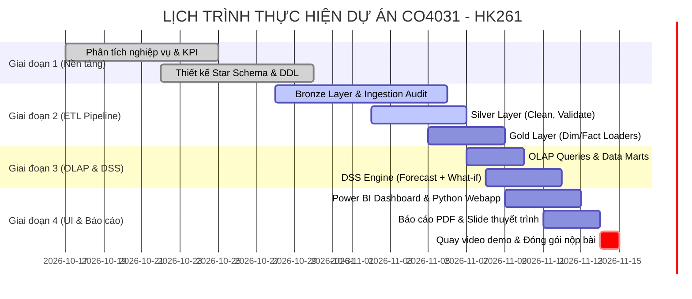

# KẾ HOẠCH DỰ ÁN CHI TIẾT (REVISED MASTER PLAN)
## XÂY DỰNG KHO DỮ LIỆU & HỆ HỖ TRỢ QUYẾT ĐỊNH (DATA WAREHOUSE & DSS)
### DỰ ÁN: GLOBAL SUPERSTORE E-COMMERCE ANALYTICS & DSS
**Môn học:** Kho dữ liệu và Hệ hỗ trợ Quyết định (CO4031) - HK261 (Năm học 2026–2027)  
**Giảng viên phụ trách:** ThS./TS. Đỗ Thanh Thái - Khoa KH&KT Máy Tính, Trường ĐH Bách Khoa ĐHQG-HCM  
**Thời hạn chót nộp bài (Hard Deadline):** **23:59 Chủ Nhật, ngày 15/11/2026 (Cuối Tuần 12)**  
**Lịch thuyết trình:** Tuần 13 - 15 (Từ 19/11/2026 đến 03/12/2026)  
**Tập dữ liệu nguồn:** *Global Superstore* (~51.290 bản ghi chính giai đoạn 2011–2014) + *Sample Superstore* (~10.000 bản ghi để test nạp tăng trưởng/incremental load).

---

## 1. THÀNH VIÊN VÀ PHÂN CÔNG TRÁCH NHIỆM

| Thành viên | Vai trò chính | Nhiệm vụ trọng tâm |
|---|---|---|
| **Tiến Nhất** (Leader) | Data Architect & DSS / Backend Engineer | - Phân tích nghiệp vụ, bộ chỉ số KPI. - Thiết kế Star Schema, định nghĩa Grain, Fact & Dimension tables. - Khởi tạo Database, viết DDL (Bronze, Silver, Gold, DSS). - Phân tích mô hình DSS (What-if, Sales Forecasting, Association Rules). - Xây dựng backend API & tích hợp giao diện tương tác DSS. - Rà soát kiến trúc và tổng hợp báo cáo kỹ thuật. |
| **Thành Phát** | Data Engineer & Data Quality Specialist | - Phát triển & kiểm thử Bronze layer (Ingestion logging, dedup, hash check). - Xây dựng Silver layer (Làm sạch, chuẩn hóa kiểu dữ liệu, chuẩn hóa ngày tháng, xử lý NULL). - Nghiên cứu & thử nghiệm flow nạp dữ liệu tăng trưởng (Incremental Load). - Viết các câu truy vấn OLAP mẫu & kiểm thử tính toàn vẹn (Fact grain, foreign keys). - Soạn thảo Slide thuyết trình & kịch bản demo video. |
| **Đức Phát** | BI Engineer & Technical Writer | - Thiết kế giao diện Dashboard khung & layout trực quan hóa. - Xây dựng Dashboard Power BI (Sales, Product, Customer Performance). - Đồng hiện thực các câu truy vấn OLAP (Roll-up, Drill-down, Slice, Dice, Pivot). - Tích hợp dữ liệu Gold/DSS vào giao diện người dùng. - Phác thảo và hoàn thiện Báo cáo tổng kết (PDF report). |

---

## 2. TIẾN ĐỘ THỜI GIAN THEO LỊCH TRÌNH MÔN HỌC

---

## 3. BẢNG PHÂN RÃ CÔNG VIỆC CHI TIẾT (WORK BREAKDOWN STRUCTURE)

### Giai đoạn 1: Phân tích nghiệp vụ, Mô hình dữ liệu & Khởi tạo CSDL
*Mục tiêu: Đặt nền móng vững chắc cho Data Warehouse và hệ thống phân tích.*

| STT | Đầu công việc | Chi tiết kỹ thuật | Người phụ trách | Hạn hoàn thành | Trạng thái |
|:---:|---|---|:---:|:---:|:---:|
| 1.1 | **Phân tích nghiệp vụ & Xác định KPI** | - Xác định 3 nhóm bài toán: Sales Performance, Product Portfolio, Customer Analytics. - Định nghĩa rõ công thức 15+ KPIs cốt lõi (Doanh thu, Lợi nhuận gộp, Margin %, Return rate, AOV, RFM scores). | Tiến Nhất | 28/10 | **HOÀN THÀNH** |
| 1.2 | **Thiết kế Star Schema & Xác định Grain** | - Xác định grain: *Một dòng sản phẩm thuộc một đơn hàng chi tiết* (`Row ID` / `Order ID + Product ID`). - Thiết kế 5 Dimension: `DimDate` (Role-playing), `DimCustomer`, `DimProduct`, `DimGeography`, `DimShipMode`. - Thiết kế 1 Fact trung tâm: `FactSales` (Chứa Additive measures & Degenerate IDs). | Tiến Nhất | 30/10 | **HOÀN THÀNH** |
| 1.3 | **Khởi tạo Database & DDL ban đầu** | - Viết script DDL tạo 4 Schemas: `bronze`, `silver`, `gold`, `dss`. - Tạo cấu trúc bảng chuẩn hóa khóa ngoại, surrogate keys, index tăng tốc. | Tiến Nhất | 02/11 | **HOÀN THÀNH** |

---

### Giai đoạn 2: Hiện thực Medallion ETL Pipeline (Bronze - Silver - Gold)
*Mục tiêu: Pipeline tự động đọc nguồn, làm sạch, chuẩn hóa và nạp vào Star Schema.*

| STT | Đầu công việc | Chi tiết kỹ thuật | Người phụ trách | Hạn hoàn thành | Trạng thái |
|:---:|---|---|:---:|:---:|:---:|
| 2.1 | **Hoàn thiện Bronze Layer** | - Module nạp file (XLS/CSV) vào `bronze.raw_orders`, `bronze.postal_code`, `bronze.market`. - Bảng `bronze.ingestion` lưu vết: `source_name`, `content_hash`, `loaded_time`, metadata. - Cơ chế chống trùng lặp dữ liệu nạp lại (Idempotency). | Thành Phát | 05/11 | **HOÀN THÀNH** |
| 2.2 | **Xây dựng Silver Layer** | - Xử lý làm sạch: Chuẩn hóa cột, ép kiểu chuẩn PostgreSQL (`numeric`, `integer`, `date`). - Xử lý định dạng ngày tháng đa dạng (`d/m/Y`, `d-m-Y` -> `DATE`). - Xử lý missing values: Impute `Postal Code` theo City/State/Country hoặc fallback `'Unknown'`. - Validate dữ liệu: Script `check_nulls.sql`, `check_duplicates.sql`, `check_data_quality.sql`. | Thành Phát | 07/11 | **HOÀN THÀNH** |
| 2.3 | **Xây dựng Gold Layer (Dimensional ETL)** | - Nạp `DimDate` (sinh tự động 2011–2016 đầy đủ 365 ngày/năm). - Nạp `DimCustomer`, `DimProduct`, `DimGeography`, `DimShipMode` (SCD Type 1 với surrogate keys). - Nạp `FactSales`: Lookup surrogate keys từ Silver, nạp measures (`sales`, `quantity`, `discount`, `profit`, `shipping_cost`). | Tiến Nhất + Thành Phát | 09/11 | **HOÀN THÀNH** |
| 2.4 | **Incremental Loading Test** | - Thử nghiệm nạp file 51k records gốc, sau đó nạp gia tăng file bổ sung để chứng minh pipeline hỗ trợ nạp dữ liệu định kỳ. | Thành Phát | 10/11 | **SẴN SÀNG TRIỂN KHAI** |

---

### Giai đoạn 3: Hiện thực OLAP Queries & Module Hỗ trợ Quyết định (DSS)
*Mục tiêu: Đạt chuẩn đầu ra môn học về OLAP Engine và thành phần DSS thông minh.*

| STT | Đầu công việc | Chi tiết kỹ thuật | Người phụ trách | Hạn hoàn thành | Trạng thái |
|:---:|---|---|:---:|:---:|:---:|
| 3.1 | **Bộ truy vấn hiện thực các thao tác OLAP** | - Viết SQL nâng cao: **Roll-up** (tổng hợp từ Ngày -> Tháng -> Quý -> Năm; Thành phố -> Quốc gia -> Vùng). - **Drill-down** (chi tiết hóa từ Danh mục -> Phân khúc sản phẩm -> Từng mã SKU). - **Slice & Dice** (lọc theo năm cụ thể và vùng cụ thể; đa chiều). - **Pivot** (chuyển đổi doanh số theo quý thành cột so sánh). - **Window Functions** (Rank doanh số, tính Tốc độ tăng trưởng MoM/YoY, Tỷ trọng Pareto 80/20). - Tạo **Materialized Views** (`mv_sales_mart`, `mv_product_mart`, `mv_customer_mart`). | Đức Phát + Thành Phát | 10/11 | **HOÀN THÀNH** |
| 3.2 | **Thiết kế & Phân tích thuật toán DSS** | - Lựa chọn kết hợp 3 tính năng DSS có giá trị thực tiễn cao:   1. *What-If Discount & Profit Simulation*: Cho phép nhà quản trị điều chỉnh tỷ lệ chiết khấu (Discount %) theo danh mục/khu vực để mô phỏng sự biến thiên của Lợi nhuận và Biên lợi nhuận.   2. *Sales & Demand Forecasting*: Dự báo doanh số 3–6 tháng tiếp theo theo chuỗi thời gian (Moving Average / Exponential Smoothing / Holt-Winters) kèm khoảng tin cậy.   3. *Association Rule Mining (Market Basket)*: Khai phá luật kết hợp sản phẩm mua kèm (Apriori/FP-Growth) phục vụ chiến lược cross-selling. | Tiến Nhất | 11/11 | **HOÀN THÀNH** |
| 3.3 | **Pipeline DSS & Lưu trữ kết quả** | - Viết script Python (`src/dss/`) đọc từ Gold layer, huấn luyện mô hình, lưu kết quả và run metadata vào schema `dss` (`dss.forecast_run`, `dss.forecast_result`, `dss.association_rule`). | Tiến Nhất | 12/11 | **HOÀN THÀNH** |

---

### Giai đoạn 4: Trực quan hóa (Power BI & Python Web App), Báo cáo & Đóng gói
*Mục tiêu: Hoàn thiện sản phẩm bàn giao, trực quan sinh động và đáp ứng mọi tiêu chí chấm điểm.*

| STT | Đầu công việc | Chi tiết kỹ thuật | Người phụ trách | Hạn hoàn thành | Trạng thái |
|:---:|---|---|:---:|:---:|:---:|
| 4.1 | **Xây dựng Dashboard Power BI** | - Kết nối PostgreSQL schema `gold` và `dss`. - Xây dựng 3 trang dashboard nghiệp vụ: Executive Sales Performance, Product Category & Cross-selling, Customer Segment & RFM. - Tích hợp Slicers, Drill-through, Bookmarks hỗ trợ tương tác trực quan. | Đức Phát | 13/11 | **ĐANG TRIỂN KHAI** |
| 4.2 | **Xây dựng Web App tương tác DSS (Python/Streamlit)** | - Xây dựng giao diện web trực quan nhẹ nhàng bằng Streamlit/FastAPI đặt tại `src/app/`. - Hỗ trợ người dùng kéo thanh trượt (slider) để chạy trực tiếp **What-If Simulation** (Điều chỉnh chiết khấu -> Nhận diện ngay nguy cơ lỗ vốn). - Trực quan hóa kết quả dự báo doanh thu và ma trận luật kết hợp. | Tiến Nhất + Đức Phát | 13/11 | **HOÀN THÀNH** |
| 4.3 | **Soạn thảo Báo cáo tổng kết (PDF)** | - Cấu trúc theo chuẩn bài tập lớn Bách Khoa: Tổng quan, Kiến trúc Medallion, Thiết kế Star Schema, Quy trình ETL, Thao tác OLAP, Phân tích & Hiện thực DSS, Đánh giá kết quả & hạn chế. - Xuất file PDF chính thức có bìa kèm thông tin nhóm và link video. | Đức Phát + Tiến Nhất | 14/11 | **ĐANG SOẠN THẢO** |
| 4.4 | **Thiết kế Slide thuyết trình** | - Soạn 20–25 slides súc tích: Bài toán kinh doanh, Mô hình Star Schema, Pipeline ETL, Demo OLAP/DSS, Bài học rút ra. | Thành Phát | 14/11 | **ĐANG THIẾT KẾ** |
| 4.5 | **Quay Video Demo & Đóng gói nộp bài** | - Quay video dài 10–15 phút, cả 3 thành viên đều tham gia trình bày phần của mình. - Upload YouTube (Unlisted) hoặc Google Drive mở quyền xem. - Kiểm tra lại toàn bộ mã nguồn, cấu hình Docker, xuất file ZIP theo đúng quy chế BTL. | Cả nhóm | 15/11 (Trưa) | **CHỜ THỰC HIỆN** |

---

## 4. CHIẾN LƯỢC: POWER BI HAY PYTHON CHO DASHBOARD & DSS?

### Đánh giá so sánh:
1. **Power BI:**
   - *Ưu thế:* Cực mạnh về trực quan hóa BI, khả năng Slice & Dice, Drill-down/Roll-up linh hoạt chỉ bằng thao tác kéo thả chuột, biểu đồ chuẩn doanh nghiệp.
   - *Hạn chế:* Chạy trên Windows Desktop; chức năng tương tác What-if động đa biến tương đối giới hạn (thường phải dùng Parameter DAX đơn giản); khó nhúng mô hình ML phức tạp chạy realtime cho người chấm nếu người chấm không cài sẵn Power BI Desktop hoặc dùng macOS/Linux.
2. **Python Web App (Streamlit / FastAPI):**
   - *Ưu thế:* Hoàn toàn độc lập nền tảng, đóng gói chạy 1 lệnh (`python -m src.app.main` hoặc qua Docker), cho phép tương tác trực tiếp với mô hình DSS (What-if slider, real-time demand calculation, Association rules graph). Thể hiện năng lực kỹ thuật và đúng định nghĩa "Hệ hỗ trợ quyết định (DSS)" theo giáo trình Turban.
   - *Hạn chế:* Cần code giao diện, mất thời gian nếu làm Dashboard BI quá nhiều trang chi tiết.

### => Quyết định tối ưu: KIẾN TRÚC SONG HÀNH (HYBRID SOLUTION)
- **Power BI (.pbix):** Dành cho phần **Báo cáo BI & OLAP Đa chiều** (Sales, Product, Customer Performance Dashboard).
- **Python DSS Web App (`src/app/`):** Dành riêng cho phần **Thành phần Hỗ trợ Quyết định (Interactive DSS Component)**:
  - Cho phép người ra quyết định thử nghiệm các kịch bản What-if (Ví dụ: "Nếu giảm giá bàn làm việc 15% ở thị trường APAC thì lợi nhuận ròng thay đổi ra sao?").
  - Xem trực quan hóa dự báo xu hướng tương lai và danh mục sản phẩm gợi ý bán kèm.
- **Dữ liệu thống nhất (Single Source of Truth):** Cả hai công cụ đều đọc trực tiếp từ các bảng `gold.*` và `dss.*` trong PostgreSQL.

---

## 5. BẢNG THEO DÕI SẢN PHẨM BÀN GIAO (DELIVERABLES CHECKLIST)

| Sản phẩm bàn giao | Định dạng / Vị trí | Yêu cầu kỹ thuật | Trạng thái |
|---|---|---|:---:|
| **1. Báo cáo BTL** | File PDF (`reports/BTL_CO4031_NhomXX.pdf`) | Bố cục chuẩn mực, đầy đủ lý thuyết DW/DSS, sơ đồ Star Schema, giải thích ETL, kết quả OLAP, mô hình DSS, đánh giá hạn chế. | 📝 Đang viết |
| **2. Mã nguồn toàn diện** | Thư mục `src/` (SQL, Python, App) | Code chuẩn hóa PEP8, có tài liệu hướng dẫn chạy, test case, idempotent ETL. | 💻 60% |
| **3. Dữ liệu mẫu** | Thư mục `data/` hoặc link Drive | Có file 51k records gốc và file sample 10k nạp gia tăng. | 📦 Sẵn sàng |
| **4. Slide báo cáo** | File PDF (`slides/CO4031_Presentation.pdf`) | Trực quan, nêu bật điểm nhấn kỹ thuật và mô hình DSS. | 🎨 Chờ làm |
| **5. Video thuyết trình** | Link Youtube (Unlisted) / Drive tại bìa báo cáo | Thời lượng 10–15 phút, cả 3 thành viên đều xuất hiện và thuyết trình. | 🎬 Chờ quay |

---

*Kế hoạch được lập ngày 04/11/2026. Nhóm cam kết rà soát tiến độ hàng ngày vào lúc 21:00 để đảm bảo hoàn thành xuất sắc dự án trước deadline 15/11/2026.*
